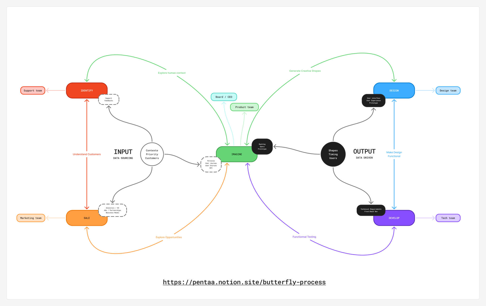

> English translation of the canonical French document. French source: [BUTTERFLY-PROCESS.md](./BUTTERFLY-PROCESS.md)

# 🦋 Butterfly Process

> English canonical methodology document for the Product Architect repository.
> Faithful translation of the French source (Notion). Do not paraphrase in agent outputs when citing this document.

## Why This Story?
My name is Benjamin Arthuys. I have been working on this process for nearly fifteen years. At first, it was only an intuition: that of a broader, more alive, more organic design than what was being offered to me. I began laying the first bricks of what would become the *Butterfly Process* in the startups where I was a founder or in a management role. Very quickly, I understood that it was not simply a product design method, but a true guiding thread for thinking, aligning, and evolving an entire organization.
Year after year, I shaped this method in contact with reality. I tested it, broke it, recomposed it. It survived failures, refined itself through successes, and grew richer with each new team, each new sector: real estate, blockchain, HR, music, video games, education... Each time, the Butterfly Process allowed me to **clarify complex situations**, to **realign a product without starting from scratch**, to **reduce friction and waste**, and above all, to ensure that **every team member feels legitimate, useful, in the right place**.
Today, I sense that the moment has come to pass it on. Not a frozen truth, but a living process. A flexible, adaptable framework that helps teams collaborate better, and individuals **find their uniqueness** in a collective adventure. This book is as much an act of sharing as a moment of reflection for myself.
The desire to set things down. To pay tribute to everything this method has allowed me to traverse and build. And perhaps, to help you too, reader, create with more meaning, clarity, and rightness.
## A Method Born in the Field
The Butterfly Process was not born in a training room, nor in a book. It was born in the field, in Barcelona, in 2012. At the time, I was discovering design thinking through Stanford's online courses. Enthusiastic about this human-centered approach, I wanted to apply it immediately in my role as a manager. I was then leading a small multidisciplinary team, a designer, a developer, a success manager, a community manager, with whom we were developing our own iOS mobile applications.
Very quickly, I understood that it was not enough to reproduce the method to the letter. The effectiveness of Design Thinking in a product unit did not translate perfectly to a full team, with its human interactions, business constraints, and work rhythms. So I began to adapt, test, transform. Without knowing it, I was laying the first bricks of what would become, a few years later, the *Butterfly Process*.
Then in 2016, I joined two founders in launching a SaaS tool for condominium management. There again, I naturally put my method back in place, with the adjustments that this new team and this new market required. The project took shape: fundraising, hiring, rapid growth... And with each change, I refined the method. I noted the friction points, the pitfalls, the needs not covered by classic methods.
What was first a *product design*-oriented process transformed into a more global, more systemic approach. I gradually expanded the method to the entire organization: sales, support, marketing, HR... Because a product is not built only between designers and developers. It is shaped with every voice, every tension, every need that runs through a team.
The Butterfly Process was therefore born in the field, in friction and iteration, like any good product. It developed in contact with very different contexts, diverse personalities, sometimes divergent objectives. And it is precisely this **variability** that pushed me to make it **agnostic**, **adaptable**, and **deeply collective**.
## Who Is the Butterfly Process For?
The Butterfly Process is for everyone who wants to **launch a project**, **create their startup**, or **structure a team around a product**.
It is particularly suited to **small teams**, **founders**, **product managers**, **heads of product**, **CPOs**, or profiles in **management positions** who seek to put in place clear, fluid, and effective processes.
It applies from the **ideation** phase, but can also be used on **already launched projects**, to regain clarity, realign the team, and re-anchor the product in user reality. Even in **scale-up** contexts, the Butterfly Process can be a powerful tool when used on **targeted teams** centered on a specific product.
This process addresses the frequent challenges of growing startups:
- Lack of clarity on roles and responsibilities
- Absence of synchronization between product, tech, design, sales, or support teams
- Difficulty structuring product iteration
- Fragmented or ineffective communication
- Velocity without clear direction
It is for those who sense that **something is not working right in the organization**, but who do not always know where to start to restore coherence.
The Butterfly Process offers a **structuring yet living approach**, which restores meaning to collective action. It helps each team **situate itself in the product cycle**, to know **what to do, when, with whom, and why**, while quickly confronting ideas with users to iterate with rightness.
## **How to Use It: Linear Reading or Modular Navigation?**
This eBook is not a frozen manual, nor a process to follow step by step like a recipe. The ***Butterfly Process*** is a living framework, a companion for reflection and action. And like any companion, it adapts to your rhythm, your needs, your context.
### **Two Ways to Explore It**
You can approach it in two main ways:
### **1. Linear Reading**
This is the most natural approach: you read the eBook from beginning to end, following the order of the chapters. This allows you to:
- Understand the philosophy of the Process
- Experience the logical evolution of the stages: from intuition to incarnation, from idea to team
- Immerse yourself in a coherent progression, designed as a transformation
This approach is particularly recommended if you are discovering the Process for the first time, or if you are going through a still fuzzy creation phase.
### **2. Modular Navigation**
You can also read this eBook as a **free navigation tool**, picking chapters according to what calls to you or what you need right now:
- Are you preparing a prototype? Go directly to Chapter 4.
- Do you want to better capture signals from the field? Dive back into Chapter 2 on empathy.
- Is your team misaligned? Open Chapter 8.
- Do you want to use it for coaching or personal transition? Head to Chapter 9.
Each chapter was designed to exist autonomously, while fitting into an overall logic. You can return to them, move through them, reread them at different moments in your project or practice.
### **The Process as a Spiral**
You will also see that as you advance, certain chapters resonate differently. Because **the Butterfly Process is cyclical**: there is no beginning and end, but loops, returns, back-and-forths between sense and action, intuition and incarnation.
That is why you can read this book **several times, at different levels**, as one revisits a map with more precision on each new journey.
### **Your Book, Your Usage**
You can highlight, annotate, cut apart, make each page your own. You can also pass it on to other members of your team, to a coach, to someone in transition.
This is not a book to understand, it is a book to live.
# **Chapter 0 - The Invisible Egg**

## **When Everything Begins in the Blur**
> *Tiny, almost invisible on the leaf, the egg nonetheless holds all the promise of life. At this stage, nothing moves, but everything is already written: the raw matter, the DNA, the invisible plan that will guide each step. It is the moment of silence before the impulse.*
Before the idea, there is intuition. Before the plan, a vibration. And before any structure, a free space.
A sacred in-between. A living void. An **invisible cocoon**.
It is in this suspended moment, where nothing is there yet, but where everything trembles, that the project begins to write itself.
Not on a whiteboard. But in a moving, subtle, often disorienting **inner matter**.
This blur is not a mistake. It is **a playground**.
> 💭 Picasso spoke of his silences as times of digestion. He sometimes let inspiration leave him so he could find it again. For him, creating was also waiting.
> 💭 	*(Inspired by his words reported in Françoise Gilot's notebooks, "Living with Picasso", 1964)*
## **The Territory of Intuition**
You have no constraints yet. No target. No logic.
That is precisely why this moment is precious:
> You can **project a thousand futures without worrying about their feasibility. **You can **draw with your heart, not with your head. **You can **invent without permission.**
Because the right idea, the one that will weather storms, inspire others, resist doubt, is never born from a strategy.
It **emerges from a shiver.** From a desire that calls to you. From a flash of emotion.
Often incomprehensible at first, but terribly alive.
> 💭 Einstein spent hours daydreaming. His equations often came after a long mental wandering. He said that "imagination is more important than knowledge."
> 💭 	*(Speech at the Berlin Academy of Sciences, 1931; reprised in "Cosmic Religion", 1939)*
## **Creative Dissolution**
When the caterpillar enters metamorphosis, it does not strengthen itself.
It **surrenders.** Its body dissolves. It becomes liquid, formless, vulnerable.
And in this biological chaos, **tiny cells called imaginals** activate.
They silently hold the plan of the butterfly to come.
They know.
> The same goes for a project.
Before it takes shape, it goes through this moment of **apparent loss**.
Of doubt. Of starting over.
It is there, in this not-knowing, that the most powerful seeds nest.
## **Resisting the Urge to Frame**
In our world obsessed with action, we would quickly want to:
- define a target
- set an MVP
- test a problem
- build a business model
But here, in this cocoon, these reflexes are traps.
They **suffocate the vibration** instead of letting it unfold.
Let your project **dream itself before you try to rationalize it.**
Let the image emerge **before you freeze it.**
> *The frame will come. But later. For now, you are in the fertile night before dawn.*
## **The Fears That Arise**
This phase can be uncomfortable. It revives familiar tensions:
- **Fear of the void**: "I don't know where I'm going..."
- **Need for control**: "I have to move forward, fast."
- **Fear of the irrational**: "This isn't concrete enough to be serious."
But if you accept them as guardians of the passage, they become **initiatory allies.**
They invite you to cross through, not to flee.
> 💭 Bowie disappeared between albums to become "nobody" again. This identity void allowed him to be reborn in a new form. For him, blur was a matrix.
> 💭 	*(Interview in the documentary "Cracked Actor", BBC, 1975; and "David Bowie: A Life" by Dylan Jones, 2017)*
## **Ritual: The Imaginals Journal**
You can create a space, physical or digital, where you deposit without filter:
- what passes through you (images, sensations, dreams, irritations)
- what returns in a loop
- what triggers an unexpected emotion
- what your body feels without you understanding why
This is your **imaginals journal**.
A sanctuary of sparks.
A compost of the invisible.
You have nothing to sort. Nothing to validate.
Just to **gather**.
> *Like a photographer in the fog, you capture barely perceptible forms. You develop them later. But for now, you observe.*
## **The Cocoon Is Already a Form**
This chapter is not a simple preamble.
It is **the true beginning of the Process.**
The most silent. The most elusive. But also the most sacred.
It is here that **you become alive again with your project.**
Before the tools. Before the sprints. Before the deliverables.
And if you listen closely...
You will see that **you are already becoming.**
## **Summary in 5 Points**
- The initial blur is **a founding passage**, not a flaw to correct.
- It is a time of **radical letting go**, where imagination is queen.
- The **cocoon metaphor** illustrates the inner transformation required.
- **Weak signals** are the imaginals: shivers, obsessions, resonances.
- The best tool here: **sensitive listening and free journaling.**
# **Chapter 1 - Imaginals: Recognizing Weak Signals**

## The Emergence of Forms
> *"What you seek is already seeking you."*
When the caterpillar enters dissolution, certain cells do not simply disappear. On the contrary, they activate. They are called imaginal cells, or *imaginals*. They hold the hidden plan of the butterfly to come. They carry the information of the future, even as the old body is liquefying.
In a project, it is exactly the same thing. Before the idea is clear, before the product exists, there are signs, flashes, fleeting intuitions. These are the project's imaginals. Phrases that obsess us. Images that return in a loop. Persistent irritations. Vivid and repeated emotions in the face of a given situation. They are not yet constructed ideas, not yet objectives, not even conscious intentions. But they are there. And they resonate. They call. They whisper something.
> 💭 Virginia Woolf noted her ideas as intuition flowed, without structure, before the architecture of her novels emerged
> 💭 	*quote from "A Writer's Diary"*
Recognizing these weak signals means recognizing in oneself the first expressions of a possible future. It means admitting that something seeks to be born through us, even if we do not yet know exactly what. They are fragments of meaning, flashes of desire, spontaneous generations of energy.
Most of the time, we reject them. We classify them as distractions, whims, wastes of time. But in the Butterfly Process, we learn to welcome them. We give them a place. We understand that it is precisely in these weak signals that the seed of the strong idea lies. The imaginal is always present before structure. It precedes logic.
The body is often the first to react. A sudden lightness, a shiver, a fire in the belly, tension in the neck. These reactions are messages. The same goes for emotions: recurring anger in the face of a perceived injustice, inexplicable sadness in the face of a subject, or on the contrary vivid joy at the evocation of an experience. All these inner movements are doors. They lead toward territories the mind has not yet consciously explored.
Imaginals also manifest in repetitions. That book we come across three times in one week. That conversation we overhear by chance but that hits the mark. That word that returns again and again in our mind. These patterns are not the fruit of chance: they are markers. They signal crossings, intersections where past, present, and future collide.
This chapter is an invitation to deep listening. Not mental listening, but sensitive listening. It is not about understanding here, but feeling. Observing. Noting. Without trying to sort, analyze, or judge. It is about collecting. Trusting. Letting yourself be crossed.
During this phase, your only work is to be receptive. Let the images, desires, intuitions, discomforts come. Let them unfold without pressure. It is from them that you will be able, in the next chapters, to formulate a clear intention, set a frame, and begin to build. But for now, be the gardener of the blur. The gatherer of sparks. The cartographer of your own weak signals.
Imaginals are the invisible seeds of a future already in gestation. You do not have to understand them right away. You simply have to make room for them.
## From Signal to Image
What at first is only an irregular beat, a fleeting reflection, sometimes becomes more tangible. You may notice that certain imaginals insist. They begin to group together, to create links between them. A phrase you had noted a month ago suddenly resonates with an idea that came while walking this morning. A question that obsesses you finds an echo in a surprising conversation in a café.
> 💭 Brian Eno deliberately let phrases or sounds circulate in his studio, to capture what insisted.
> 💭 	*"Oblique Strategies" (1975)*
This is where we move from a weak signal to an archipelago of meaning. The first contours of the idea appear. It does not yet have a clear form, but it vibrates. It demands your attention. And above all, it demands a space to be nourished.
You can begin to make associations. Link words, images, memories, problems, desires. It is a living cartography. A poetic and open space where you do not need to be coherent. You must follow the thread of excitement. Create links. Play.
## Let It Live Before Framing
The classic mistake, in the first stages of designing a project, is wanting to frame too quickly. Finding the name, defining the target, planning a business model. But an imaginal prefers open air to the cage of premature precision.
This chapter invites you to unlearn productivity automatisms. Here, we do not advance to go fast. We advance to go deep. Each note, each intuition, each recurrence is a potential source of inspiration to come. Let them take their place. You are not here to validate. You are here to welcome.
> 💭 Kandinsky saw forms before knowing what they represented. He painted from a sonic or emotional resonance.
> 💭 	*from "Concerning the Spiritual in Art", 1911*
## The Intuition Journal
What I recommend is opening a physical or digital space you will call your "intuition journal." It is a space without filter, without obligation of result. You note everything that echoes. Every sensation that troubles you. Every element that creates a resonance.
This journal is the basis of your dialogue with the imaginals. It can be poetic, rough, discontinuous. But it will be a mirror. And the more you connect to it, the more the forms will sharpen. The Butterfly Process begins here: in this back-and-forth between fertile trouble and the structure to come.
## Temporary Conclusion
It is not yet time to set a definition. But you can sense that something has begun. This chapter is here to honor the invisible, the non-verbal, the nascent. Imaginals are the messengers of the project to come. Do not rush them. Do not master them. Be the attentive witness of their awakening.
# **Chapter 2 - Radical Empathy**

## **Intuition Seeks Its Mirror**
> "The shortest path to oneself often passes through the other."
You have begun to capture the first weak signals. Emotions. Tensions. Impulses. You hold in your hands an embryonic form of project. A inner vibration. But at this stage, it is still solitary, enclosed in your subjective universe.
The step that comes is that of encounter. The one where your idea leaves you to brush against the experience of others. And it is a crucial step: an idea that does not let itself be crossed by otherness risks turning empty.
The Butterfly Process invites you here to **radical empathy**, that is, a rare quality of presence, vulnerable, receptive, that goes well beyond an audience study or a marketing persona.
## **What It Really Means to Listen**
> 💭 "Deep listening is an act of silent revolution." : bell hooks
Listening within the Butterfly Process is not about seeking to confirm a hypothesis. It is **letting yourself be transformed** by the reality of the other. It is approaching the field not as a market, but as a humanity. It is coming **without filter, without agenda, without pre-established strategy.**
This supposes an inner disarmament. A suspension of certainties. An art of welcoming speech, silence, contradictions, the unsaid.
It is not about finding "what people want," but perceiving **what crosses through them.**
> *You do not come seeking an answer, you come seeking an encounter.*
In the Butterfly Process, we do not come with a questionnaire that directs the person in one direction or that comes to confirm hypotheses we would have established beforehand. What we seek are hypotheses we would never have thought of alone and that can even be counterintuitive. So we can arrive at an interview with a framework, a guiding thread that helps us stay on topic, however we leave the person the possibility to go in the direction they want.
**A concrete example:** *During a user interview to understand how to improve a search feature in a document management application, I started with the hypothesis that users wanted more filters, a faster engine, or a clearer interface.*
*But by letting the person speak freely, they mentioned something else: "I never know how to formulate what I'm looking for. I feel like I have to think like the tool for it to understand me."*
*This phrase was a turning point. It revealed a tension much deeper than a bad search engine: the feeling of having to adapt to the tool's logic, rather than the reverse.*
*The issue was not technical, but cognitive and emotional: rethinking the design so it accompanies the blurry, imperfect, human formulation of the request. What I had taken for an algorithm problem was in reality a question of posture, empathy, and dialogue between human and interface.*
## **Sensitive Empathy Techniques**
Here are some approaches you can implement in this spirit:
### **Open Interviews**
You ask open questions, you let people speak freely. You dig into emotions, metaphors, contradictions. It is not a questionnaire. It is a conversation.
### **Passive Observation**
You watch. You note. You blend into the background. You observe gestures, hesitations, detours, shortcuts. You look at what people actually do, not what they say they do.
### **Immersion**
You live yourself what your potential user lives: you spend a day in customer service, you sign up for a workshop, you use a competitor's product. You feel in your body the blockages, the ease, the absurdities.
### **Field Journal**
You take notes each day on behaviors, weak signals, intuitions that arise in relation to the field. You cross perspectives. You let patterns appear.
### **What You Must Capture**
What you are looking for at this stage are **human tensions**. Things that stick. That hurt. That create invisible effort. Or on the contrary, things that fluidify, that amaze, that reconcile.
Seek to see:
- Where does it rub?
- Where do people compensate?
- Where do they lie to hold on?
- Where do they cheat on themselves?
- Where do they adapt instead of being themselves?
And also note:
- What makes them smile without realizing it.
- What they repeat without thinking.
- What they dare not ask.
It is these places that contain **the true matter of design.**
### **Listening Is Not Neutral**
It must also be said clearly: **listening is a political act.** It is choosing not to impose your vision. It is recognizing that the other holds an essential part of truth. It is sometimes unlearning what you thought you knew.
You can be shaken by stories, confronted with realities you ignored, moved by speech that displaces you. That is normal. It is even the sign that you are in the right place.
> *Empathy does not consist in understanding the other as an object to analyze, but in feeling them as a subject who affects you.*
## **Return Transformed**
The goal of this phase is not to produce a report, but to **change your gaze.**
At the end of your empathic exploration, you should not only have verbatims. You must **feel displaced, concerned, crossed**. If that is not the case, you may have listened too fast or too superficially.
It is at that moment that you can begin to **formulate a tension**. Not a solution. Not a feature. A tension. A painful gap between what is and what could be. It is this tension that will guide you next in the definition phase.
## **Pitfalls to Avoid**
- **Listening to validate what you already thought.**
	You are not here to confirm your idea. You are here to put it back into play.
- **Transforming insights into business ideas too quickly.**
	Let tensions settle. Do not seek to monetize everything. First feel, then build.
- **Confusing empathy and projection.**
	You are not your user. Even if you have lived similar things. Learn to stay in your place while remaining porous.
## **Closing Ritual: Write the Tension**
At the end of this phase, offer yourself a moment of calm and answer this question:
> *What is the main tension I felt in this encounter with the other?*
Formulate it with simple words. Without jargon. In one sentence. It will be the compass for the next chapter.
Remember: **You do not build for people. You build with them.**
And it is in this space of co-sensation, of co-perception, that right projects take root.
# **Chapter 3 - Clear and Intentional Definition**

## From Information Chaos to the Emergence of Meaning
After diving into reality, observing, listening, feeling, you find yourself facing a mass of living information. Testimonies, gestures, pains, impulses. If the previous step allowed you to connect to others, this one will allow you to formulate a **clear tension point** from what you captured.
> 💭 *Richard Sennett speaks of "fertile resistance": this tension between what you want to do and the matter with which you do it. That is where deep creativity resides.*
Defining is not brutally framing. It is **extracting a nucleus of clarity**, without losing the richness of exploration. It is naming what resists, what returns, what hurts, what makes sense. It is identifying a fracture, a flaw, a lack, and transforming it into a **compass for action**.
## Formulate a Tension, Not a Solution
A frequent mistake is to formulate a solution right away. But it is not yet the moment. What you want now is to **circumscribe the real problem**. And for that, you must dare to stay a little in the blur. You have gathered signals, now you will cross them, group them, interpret them without freezing them.
Ask yourself the right questions:
- What returns most often?
- What provokes emotion?
- Where are the contradictions? The discomforts?
And above all: **what does it say more deeply?**
Zoom or step back? Sometimes, what you identify as a tension is a local symptom, but not yet the root.
*Example: "The user cannot find the option to edit their profile."* - Is it a button placement problem? - Or a broader confusion about navigation logic? - Or a lack of landmarks throughout the journey?
Ask yourself: Am I facing a surface tension or a structural flaw?
That too is the art of defining: knowing when to zoom and when to reframe.
## The Art of Posing a Good Problem Statement
In this phase, you are not describing a problem: you are constructing it from your reading of the field. It is a skill in itself, a way of orienting reality. A good problem statement is alive. It does not close, it opens. It is precise enough to guide, open enough to allow the emergence of varied solutions.
> 💭 "Posing a problem statement is already an act of design." : Donald Schön, The Reflective Practitioner
### Some trap formulations to avoid:
- *How might we "add an advanced filters feature"?* → That is already a solution, not a tension.
- *How might we improve our product so users find their way better?* → Too vague, too general, without a hook.
- *How might we convince our users to use feature X?* → This starts from a bias: the problem may be that the feature does not respond to a real tension.
A good formulation leaves room for the unknown. It does not suppose the answer. It invites exploration. You can rely on the well-known Design Thinking format:
### **"How Might We…?"**
> 💭 This type of formulation, "How might we…", was popularized by IDEO, notably by Tim Brown. But here, we do not use it as a method to apply mechanically. It is an open invitation, a poetic framework to explore what follows without enclosing thought.
**For example:**
- How might we reduce loneliness in creative processes?
- How might we reconnect people to their intuitions?
- How might we simplify collective decision-making?
This type of question is not trivial. It guides everything that follows.
## Synthesis, Prioritization, Alignment
Beware of what you think you see. In the synthesis phase, we tend to favor what suits us: what we understand easily, what confirms our initial intuition. But beware, certain needs are masked by collective or cultural biases.
*Example: A poorly used tool is not always poorly designed. It may be poorly introduced, poorly valued socially, or rejected because of tacit discomfort in the team.*
Learn to see beyond the surface. Look at relational dynamics, silences, detours. They are often what put you on the real trail.
You can now create a **visual synthesis** of your exploration: mapping of issues, sorting of verbatims, grouping of needs. Prioritize what returns with the most intensity. And verify if what you feel is shared by other members of your team. This is the moment to **align visions**.
You do not need total consensus, but a tension sufficiently shared to justify action. And a frame sufficiently clear to avoid getting lost in the rest of the process.
## A Moving Frame
What you will set here is not an absolute truth. It is a **temporary frame**. A compass, not a prison. You will challenge it, refine it, revisit it. But to advance, you need this first formulation. This backbone on which you can begin to build.
The next chapter will mark the passage to action: **making visible what you feel, what you understood, what you want to test**. It will be the moment to prototype.
## **📌 **Summary in 5 Points
- Project definition begins with a tension, not a solution.
- A good problem statement is both open and embodied.
- The frame set is temporary, it serves as compass, not cage.
- Clarity comes by crossing contradictions, not eliminating them.
- This step is the backbone of the cycle that follows.
# **Chapter 4 - Living Prototyping**

> 💡 *"Fail faster to succeed sooner" -* David Kelley
## Giving Body to an Intention Without Enclosing It
You have crossed intuition, encountered reality, formulated a tension. You now hold a clear intention, a felt need, a living problem statement. The moment has come to **incarnate it**.
But beware: it is not yet about building a final product. It is about **sketching**, materializing just enough to learn. The prototype is not a promise. It is a **tangible hypothesis**.
Prototyping is at the heart of the Butterfly Process because it allows exploring without enclosing oneself. It makes an idea visible, confronts it, makes it live. It does not seek to be perfect. It seeks to **be useful for learning**.
## Prototyping Is Dialoguing with Reality
A prototype is not only an object or a screen. It is an **experience**. A way of bringing the other into your universe. An invitation to interact, react, co-construct.
Prototyping is opening the discussion. It is asking the world: *"What if it were like this?"* And listening to what the world answers you.
This can be:
- A quick drawing on paper
- A fictional landing page
- A acted scenario
- A storyboard
- A fake email
- Role play
- A clickable interface
And sometimes, the prototype is not a visual object but an **emotional or symbolic support.** A fictional letter, a printed mind map, an improvised audio message: anything that gives a first existence to your intention can become a prototype.
> *"Prototyping as a tool of empathy" - *Liz Sanders
👉 What matters is not the form, but the possibility to react.
The important thing is not the medium, but the message. And above all, the possibility for your interlocutor to react, interact, show you what you had not seen.
Beware however: **if you do not state the intention of your prototype, you risk biasing the reaction.** Before showing, take 10 seconds to say:
*"This is not a finished solution, but a hypothesis I am testing. I would like to know what it awakens in you."*
This simple ritual frees speech, and avoids your interlocutor getting stuck on finish or feasibility.
## Test the Context, Not Only the Product
A frequent mistake in prototyping phases is testing only the visible form of the product: the interface, the words, the visuals. Yet, **your product will insert itself into a much broader ecosystem**: business model, market expectations, strategic partnerships, deployment timing, economic model.
That is why it is essential to **also prototype the context**:
- Test pricing with a landing page + targeted ad
- Simulate a partnership by co-branding a first piece of content
- Play a pitch simulation with an investor
- Display a product promise to see who clicks, who signs up, who shares
- Create an MVP of your ecosystem before even the technical MVP
- **Create a fake Slack or Discord group** around the project, and see if people spontaneously choose to remain active there: it is a simple way to test appetite for a community before even having a finished product.
The goal here is to understand if your project is **not only desirable** for users, but also **viable** for your business. Many technically brilliant projects fail for not having validated their anchoring in the real world.
## Learn Fast, Adjust Often
The prototype is in service of **rapid iteration**. You do not make a prototype to convince. You make a prototype to learn.
But beware: **a prototype that is too "pro" can mislead you.** If your design is already very polished, very finished, your interlocutor will not dare to criticize. They will judge aesthetics instead of pointing to the tension. Stay deliberately **imperfect**: a sketch, a shaky mockup, a poorly acted scenario. It is in this fragility that you will get the most sincere feedback. To discover what you had misunderstood, what you had not seen, what truly resonates.
The earlier you prototype, the faster you will discover what is essential. You will save time, energy, frustration. You will above all **develop a feedback intelligence**. Because a good prototype does not only tell you if an idea is good: it shows you **how it is perceived**.
## The Continuous Loop
In the Butterfly Process, prototyping is a **permanent movement**. It is not a single step. It is a loop. We prototype, we test, we learn, we readjust, we re-prototype.
This chapter invites you to create in matter, to leave the mental, to give form to your intuitions. Even if it is ugly. Even if it is not finished. What matters is that **you begin to give the project an existence**.
It is the moment to do. To show. To set fragile but real forms. Because it is by seeing an idea materialize that we finally understand what it wants to become.
In the next chapter, we will see how this matter gains coherence, elegance, and begins to build a true experience: it is the time of embodied design.
# **Chapter 5 - Embodied Design**

> *Design is not only appearance, it is also how it works."* : Steve Jobs
## From Draft to Living
After sketching your idea, making it visible through prototypes, you enter a finer, more sensitive, almost organic phase: that of **embodied design**. It is no longer only about showing or testing a raw form, but **sculpting a coherent, aligned, meaningful experience**.
Design here does not reduce to aesthetics. It is an **intelligence of form in service of substance**. It gives coherence, fluidity, emotion to what you want to make live. It is at that moment that your project begins to touch, to speak, to vibrate for the other.
> 💡 *Good design hides nothing. It reveals intention.*
## Design = Relationship
Design is not a wrapper. It is a **relationship built between your intention and the experience lived by the user**. It translates choices. It makes priorities visible. It guides, soothes, excites, orients.
You must ask yourself deep questions:
- What do you want the person to feel in contact with your project?
- What posture do you want them to adopt?
- What emotion do you want them to keep afterward?
Example: *Do you want your user to feel guided like in a museum, or free like on a walk in the forest?*
These questions are more important than the color of the button. They are the foundation on which you will design every detail.
> 🔍 *If your design tells too much, it tires. If your design tells nothing, it loses.*
## Building an Invisible Narration
Good design tells a story. It creates an atmosphere. It installs an internal coherence. Even if it is minimal, even if it is raw. Embodied design is this capacity to pass a message without saying it.
You can see it as a **story arc**:
- An introduction (we welcome)
- A tension (we guide, we surprise)
- A resolution (we release, we close)
Each user journey is a small story. Every detail must reinforce this rhythm. It is transmitting an intention through the arrangement of elements, the fluidity of the journey, the balance of volumes, the rhythm of interaction.
It is also an invitation to respect: respecting time, attention, the other's perception. Good design does not shout. It invites. It leaves space.
## Collaboration and Emergence
At this stage, the designer does not work alone. They exchange with product, marketing, tech. They capture user feedback, they navigate between constraints. They listen to the project, as one listens to a living being seeking its form.
Embodied design often emerges from **contradictory feedback**:
- Marketing pushes for more clarity
- Tech demands more simplicity
- Design seeks more coherence
That is what makes it powerful: it is **the fruit of a fragile balance between aesthetics, function, emotion, and context**. It is from this tension between sensibilities that rightness is born.
> ✨ *The detail is never trivial. It is a fragment of soul.*
## Final Alignment
When a design is right, everything aligns. Meaning becomes perceptible. Experience becomes fluid. Intention becomes palpable. It is that moment where you sense your idea is settling into the world, no longer as a concept, but as a sensible reality.
> ⚠️ Beware: a design that is too polished can kill the soul of the project. By polishing, optimizing, uniformizing, we erase singularity. You must know how to preserve the initial vibration in the final form.
This chapter is a tribute to this often neglected, yet crucial stage: the one where we give to see, to touch, to feel. The one where we honor the user by offering them a right experience.
# **Chapter 6 - Anchored Development**

## Making It Exist Without Betraying
When design has been refined, embodied, felt, comes the ultimate step of the materialization cycle: **development**. It is here that your idea leaves the world of intentions to enter matter. It becomes **functional**, **operational**, **alive** in the digital real.
But beware: development is not simple technical execution. It is a **creative act in its own right**. It engages choices, compromises, arbitrations. And it is precisely because it is often perceived as a rigid or closed phase that it is essential to place it back at the heart of the living process.
> *"Any fool can write code that a computer can understand. Good programmers write code that humans can understand." -  *Martin Fowler (software architect, ThoughtWorks)
## Code as Craft
A good developer is not a robot that translates mockups into lines of code. They are an **artisan of structure**, a sensitive translator between vision and technical reality.
They take constraints into account, optimize, adjust, let the interface breathe, decide interaction logics.
As Richard Sennett writes in *The Craftsman*, the artisan does not seek only to produce, but to **do well to give meaning to what they create**.
There is an intrinsic dignity in clean, readable code, thought to last. Well-written, well-thought, well-set code is invisible to the user. And yet, it conditions the entire experience. It carries intention all the way into the click, into responsiveness, into the fluidity of transitions.
Example: the choice to optimize a query to avoid imperceptible latency, or adding a micro-animation that makes a gesture more intuitive.
Details almost invisible, but that transform the global perception of the product.
> 💡 *Right code is invisible. It makes you forget its presence.*
## The Product-Tech Loop
In a mature Butterfly Process, dialogue between the product team and the technical team is **permanent**. It is not about delivering a specification document, but collaborating through adjustments, in a living loop.
Development does not only serve to validate ideas. It can also challenge them. It is an opportunity to **anchor meaning in the limits of the feasible**, refine priorities, and let coherence breathe. As Kent Beck, pioneer of Extreme Programming, reminds us: *"Make it work, make it right, make it fast."* This logic perfectly embodies the product-tech loop: we validate an intention, we clarify it, then we optimize it in a constant back-and-forth.
*Example: A team wanted to integrate complex multi-criteria search. By exchanging with developers, they discovered that simple full-text search + progressive filters brought 80% of the value for 20% of the effort.*
The technical solution redefined the product vision, while improving the experience.
👉 That is why you must plan space for back-and-forths, for iteration, for technical exploration.
The ideal is for developers to be involved very early in the process, so they understand the **soul of the project**, not only its surface.
> 🔍 *Do not reduce development to execution. It is a sensitive translation.*
## The Art of Delivering Consciously
Launching a project online is not an end. It is an **act of birth**. What you deliver to the world will be explored, tested, judged, loved, diverted. You must therefore deliver with **responsibility**.
Taking care of code as one takes care of a house being opened. Delivering consciously means understanding that development does not stop at "it works."
It is anticipating **invisible debt**:
- neglected security that becomes a flaw,
- forgotten accessibility that excludes people,
- too fragile architecture that blocks growth.
👉 A product can seem functional, but if delivered without these attentions, it already carries future fractures within it.
*Example: A team launches its product with an unoptimized database. Everything works well at first... until the number of users explodes. Slowness appears, crashes multiply. It was not a bug, but invisible debt: the failure to anticipate growth.*
That is why delivering consciously means integrating from the start an ethical and sustainable posture. It is not slowing down for the sake of slowing down. It is **choosing to protect what truly matters**: trust, inclusion, perceived quality. This chapter is an invitation to reconsider development as a **sensitive, open, adjustable phase**, where we continue to make ethical, aesthetic, functional choices. It is here that the project becomes real. It is here that it fully joins the world.
# **Chapter 7 - The Double Loop: A Living System**

## A Cyclical and Organic Movement
Until now, you have crossed all the stages: intuition, empathy, definition, prototyping, design, development. The cocoon is cracked. The butterfly appears. Still fragile, crumpled wings, but alive.
This is the moment where the **Butterfly Process takes its full dimension**: no longer as a sequence of steps, but as a cyclical dynamic, a continuous breath.
The Butterfly Process is not a straight line. It is not a frozen sequence of steps to check off. It is a **continuous breath**, a **living system** that alternates exploration and incarnation, sense and matter, listening and action.
### **The Two Loops**
At this stage, you have crossed the two loops of the process:
- The first, carried by intuition, observation, and definition, allowed you to **formulate the sense** of your project.
- The second, carried by prototyping, design, and development, allowed you to **incarnate it in reality**.
But these two loops do not succeed each other only once. They **nourish each other permanently** with the product at their center. *Each loop nourishes the other. Each relaunched tension becomes an opportunity to grow.*
Like the two wings of a butterfly: it is their repeated movement that moves the body forward.
## A Living Dynamic
As your product advances, as your project evolves, new tensions emerge. New ideas appear. New needs make themselves felt. And the cycle begins again. You return to listening → you redefine → you readjust → you redeploy.
This **double loop** is what makes the Butterfly Process alive. It saves you from the rigidity of linear plans. It authorizes you to learn while walking. It helps you stay listening to the essential, while advancing concretely. This movement is not a closed circle. It is an **evolutionary spiral**: with each pass, you deepen, you refine, you become more right.
You do not need to understand everything before acting. You do not need to freeze before creating. You can circulate between the two loops, as one breathes between inspiration and expiration.
## Mapping Transformation
In a team, each person can situate themselves in a different loop. Some are more in listening, exploration, intuition. Others are more in concretization, shaping, implementation. And all are necessary. All are part of the cycle.
That is also why the Butterfly Process is **a collective alignment tool**. It allows each person to know where they situate themselves. To assume their role without confusion. And to dialogue with the other loops of the project.
The double loop protects you from two classic drifts:
- The rigidity of linear plans (*we plan everything in advance, we no longer move*).
- Disordered agitation (*we move all the time without direction*).
The infinite loop invites you to integrate this **cyclical, adaptive, living** logic into your way of working, creating, collaborating. It inscribes your project in a logic of **natural cycle**, made of returns, breaths, adjustments.
> ♾️ A project that breathes is a project that evolves. A project that evolves is a project that learns.  A project that learns is a project that lasts.
# **Chapter 8 - Activating a Team Around the Process**
### From Diagram to Collective Dynamic
The Butterfly Process may at first seem like a diagram, an individual journey, or project logic. But its true potential reveals itself **when it becomes a common language**, a shared reference for an entire team. Because a good idea is nothing if it does not incarnate in a human dynamic.
Activating a team around the Butterfly Process means offering everyone **a map to situate themselves** and **a grammar to collaborate**. It allows each member to understand what stage they are at, what their role is, and how they can contribute with rightness.
### A Common Compass
In a team, we often find tensions linked to a lack of reference points. Some rush into production without clarifying intention, others remain stuck in reflection without ever prototyping. Design and tech speak poorly to each other, and user feedback arrives too late. These misalignments create a dull fatigue: **everyone works, but not necessarily at the same rhythm** nor with the same compass.
The Butterfly Process allows **setting a common frame**, fluid but structuring. Everyone can visualize the stages, understand where the project stands, and adapt their energy accordingly.
*Example: I accompanied a team where the project was running out of steam: field feedback arrived in direct flow to tech, without a real translation or prototyping phase. Everyone worked, but in different logics, and the product advanced without a clear direction. By introducing the Butterfly Process, signals found their right place in the sense loop, before passing into the incarnation loop. Simply setting this common language allowed restoring alignment and giving the project new momentum.*
The strength of this compass is that it does not impose a rigid frame. It creates a flexible structure, a **shared language that fluidifies the circulation of information and energy**. Everyone can visualize the project stage, adapt their energy, understand that of others. Alignment is no longer a constraint, but a common breath.
### **Input/Income - Output/Outcome: Rethinking Balance in the Organization**
In an organization, we often tend to separate teams into silos, according to their function: sales, marketing, support, product, design, tech, etc. The Butterfly Process proposes another reading grid: an **energetic and systemic** reading, centered on the circulation of value in the organization.
### **Two Poles: Upstream and Downstream of the Process**
We can map the organization around two poles:
- **The Input/Income pole**:
	It groups teams that **collect** signals, tensions, needs (input) while **generating revenue** or visibility (income).
	👉 We find marketing, sales, support, communication, partners...
- **The Output/Outcome pole**:
	It groups teams that **produce** the tangible deliverable (output) and aim for a **concrete result** (outcome) for the user.
	👉 We find developers, designers, engineers, ops...
Between the two, a team bridges, ensures translation, maintains direction: **the product team**.
### **Reconciling Information Flow and Value Flow**
This diagram allows moving out of silo logic to adopt a **circular and systemic** vision:
- Input/Income teams feed the sense loop. They report field reality, weak signals, friction, potential.
- Output/Outcome teams incarnate the action loop. They concretize, test, deliver.
- The product team operates the **breath between the two loops**, ensuring fluid circulation between understanding and execution.
### **Strategic Consequence**
This vision also allows **revaluing so-called "support" functions**, like customer service or sales, which are not "outside the product" but **at the heart of feeding the Process**.
It also allows avoiding a frequent drift: development for development's sake, or creating features without direct link to concrete inputs.
The facilitator's role, in this logic, is to **orchestrate symmetry between what enters and what exits**, between real inputs and relevant outputs, between revenue and impact.
### The Facilitator's Posture
For this process to work at team scale, we often need one or more **facilitators**. People who are not there to control, but to maintain movement. Their role is to:
- Keep clarity on the stage the project is in
- Ensure everyone can contribute at their level
- Reactivate listening, reformulation, questioning
- Favor back-and-forths between exploration and execution
This role can be embodied by a product manager, a coach, a designer, a founder... It does not matter. What matters is **the posture of active listening and fluid regulation**.
# Chapter 9 - The Sense Loop
### Activating Peripheral Functions: Sales, Marketing, Support
One of the essential contributions of the Butterfly Process is to **fully integrate functions often considered peripheral**: sales, marketing, customer support, partner relations, etc.
Too often, these teams are mobilized only downstream of development. Here, **they become sensors, scouts, nourishers of the process from the start**.
### The Sales Team → Empathy Amplifier
Salespeople are in direct contact with clients. They hear objections, unformulated desires, recurring frustrations. They can:
- Share field verbatims useful for the empathy phase
- Validate appetite for a prototype before even its development
- Co-create pitches from the design phases
### Marketing → Clarifier of Sense and Intention
Marketers have a narrative vision, they know how to translate an intention into message. They can:
- Participate in the definition phase to help formulate the offer
- Create content that accompanies tests (landing pages, campaigns, storytelling)
- Measure the emotional impact of messages to nourish the loops
### Customer Support → Mirror of Usage Reality
Support is a treasure for the test phase: it sees where things stick, where real experience diverges from intention. It can:
- Nourish the definition of a new version from tickets
- Identify unexpected usage or blockage patterns
- Be a force of proposal to adjust journeys or features
➡️ Integrating these teams into the loop means offering yourself a richness of information, a finesse of analysis, and an overall coherence that goes beyond simple product logic.
In the next chapter, we will see how this logic can apply **beyond the product**, in varied contexts like education, coaching, or even personal transformation.
# Chapter 10 - The Incarnation Loop

> Operational map: [Pentaa - App Builders (FigJam)](https://www.figma.com/board/7YQbMLEPV43LCcFzGeBoQP/Pentaa---App-Builders?node-id=2-885)
## Giving Form to What Has Meaning
Chapter 9 showed how peripheral functions, sales, marketing, support, **nourish the sense loop**. This chapter maps the **incarnation loop**: how a clarified intention becomes form, function, and reality in the world.
This is not a linear sequence. It is a **butterfly system**: two wings around a beating heart, with flows that rise, descend, and return permanently.
## The Heart: IMAGINE
At the center of the diagram is **IMAGINE**: the hub where strategy and execution converge.
It is here that we hold the thread between:
- the **vision** carried by the Board / CEO
- the **operational translation** carried by the product team
- the **framing artifacts**: Personas, User Journey, User Stories, KPI
- the **passage-to-action deliverables**: Backlog, Specs, Prototype
IMAGINE is not a dreaming phase. It is the **conversion point** between what was understood (sense loop) and what will be built (incarnation loop).
### Flows from IMAGINE
| Direction | Label | Meaning |
| --- | --- | --- |
| Toward IDENTIFY | Explore human context | Return to human field to refine context |
| Toward SALE | Explore Opportunities | Explore market opportunities, revenue, partnerships |
| Toward DESIGN | Generate Creative Shapes | Generate creative shapes from intention |
| From DEVELOP | Functional Testing | Development nourishes IMAGINE through functional tests |

## Left Wing: INPUT (Data Sourcing)
This wing collects and structures **real-world data** before and during incarnation.
### Core: Context, Priority, Customers
At the center of the left wing: **Context, Priority, Customers**: what orients the entire input chain.
### IDENTIFY (Support Team)
- **Role**: capture usage reality, friction, field feedback
- **Artifacts**: Support Feedbacks
- **Vertical link** with SALE: *Understand Customers*: understand the client in their entirety (usage + market)
The support team is not downstream of the product. It is an **input sensor** for the incarnation loop.
### SALE (Marketing Team)
- **Role**: explore commercial opportunities and viability
- **Artifacts**: Analytics / BI, Ads / Partnerships, Business Model
- **Loop** with IMAGINE: *Explore Opportunities*
The marketing team feeds viability while the product takes shape: not after the fact.
### Cross-cutting Artifacts (input → IMAGINE)
**Personas, User Journey, User Stories, KPI**: the structured matter that allows IMAGINE to hold course without losing the link to the field.
## Right Wing: OUTPUT (Data Driven)
This wing **materializes** intention into experience and code.
### DESIGN (Design Team)
- **Role**: give sensitive and coherent form to intention
- **Artifacts**: User Interface, User Experience, Prototype
- **Vertical link** with DEVELOP: *Make Design Functional*
### DEVELOP (Tech Team)
- **Role**: make design functional, deliverable, testable
- **Artifacts**: Technical Requirements, Front/Back Dev
- **Return loop** toward IMAGINE: *Functional Testing*
Development is not an end: it is a **data source** that re-feeds the center.
### Coordination Core: Shapes, Timing, Users
Between DESIGN and DEVELOP, a coordination circle, **Shapes, Timing, Users**, ensures alignment on:
- retained shapes (shapes)
- delivery rhythm (timing)
- targeted users (users)
It in turn feeds **Backlog, Specs, Prototype** at the center.
## Teams on the Map
| Team | Position | Function in the Loop |
| --- | --- | --- |
| Support team | IDENTIFY | Field input, usage feedback |
| Marketing team | SALE | Market input, opportunities, business model |
| Product team | IMAGINE | Translation, backlog, specs, prototyping |
| Board / CEO | IMAGINE | Vision, strategic direction |
| Design team | DESIGN | Form, UX, prototype |
| Tech team | DEVELOP | Function, code, tests |

## The Breath Between the Two Wings
The butterfly metaphor takes its full meaning here:
- **Left wing (INPUT)**: we collect, we understand, we prioritize: *data sourcing*
- **Center (IMAGINE)**: we convert into actionable intention
- **Right wing (OUTPUT)**: we design, we develop, we test: *data driven*
- **Return**: functional tests and re-explored opportunities re-feed IMAGINE
This is not a waterfall. It is a **continuous breath** between sourcing and delivery.
## Summary in 5 Points
- The incarnation loop is mapped in **two wings** around the **IMAGINE** hub
- The **INPUT** wing (IDENTIFY + SALE) structures context, priorities, and customers
- The **OUTPUT** wing (DESIGN + DEVELOP) materializes form and function
- **IMAGINE** converts insights into backlog, specs, and prototypes: with the Board/CEO and product team
- **Functional tests** close the loop: incarnation nourishes sense again
# **Chapter 11 - Unity Is Strength**
### **The Product Team: Guardian of Rhythm, Bridge Between the Loops**
If commercial, marketing, or support functions come to enrich the process through their specific points of contact with the outside, **the product team** is **the beating heart** of the Butterfly Process. It embodies the living link between the two loops: that of sense and that of incarnation.
### **The Transversal Role of the Product Team**
The product team is not a simple transmission belt between insights and features. It acts as a **guardian of rhythm**, a **facilitator of alignment**, a **translator of intention into experimentation**.
It constantly evolves in the fertile tension between field listening (sense loop) and concrete implementation (incarnation loop). It is the one that:
- Welcomes weak signals from imaginals, support, or sales
- Transforms these signals into hypotheses, clear tensions, problem statements to explore
- Animates prototyping cycles to bring forth the right form
- Pilots product evolution while ensuring global alignment
### **The Role of the Product Manager**
In this dynamic, **the Product Manager (PM)** often plays the role of **subtle conductor**. It is not about controlling everything, but:
- Recalling the initial vision and nourishing it with recent learnings
- Identifying priorities that will create leverage
- Making different temporalities dialogue: business, design, tech, users
- Keeping direction without rigidity
A good PM in the Butterfly Process is a **dancer**. They sense variations in energy. They know when to slow down, when to push, when to listen, when to reframe.
### **Ritualizing Movement**
The product team can put in place **rituals** specific to each loop:
- On the sense loop side:
	- Sensitive user feedback
	- Field observation sessions
	- Problem statement reformulation workshops
- On the incarnation loop side:
	- Rapid prototyping sprint
	- High-frequency qualitative tests
	- Cross-function alignment checkpoints
This **living cadence** allows maintaining creative momentum without losing collective intelligence along the way.
### **A Posture of Strategic Listening**
Finally, the product team in the Butterfly Process adopts a rare but precious posture: **strategic listening**.
It does not seek to say yes to everything.
It does not seek to validate everything with numbers.
It develops an **informed collective intuition**. A capacity to sense what is right for the project, at a given moment, integrating both field feedback, long-term vision, and operational reality.
### **The Product Team as Conversion Chamber**
The product team acts as **central converter**. It is the transformation zone between input from reality (insights, tensions, demands) and output from creation (features, products, services).
Its role is to:
- **Filter and prioritize** inputs: which feedbacks reveal a deep issue?
- **Formulate a clear tension**: how to transform a fuzzy need into a design opportunity?
- **Pilot materialization**: how to incarnate this tension in a product that creates a measurable outcome?
It thus links:
| **Input →** | **Field signal, client need, insight, tension** |
| --- | --- |
| Income → | Revenue, leads, commercial opportunities |
| Output → | Product, feature, design, experience |
| Outcome → | Perceived result, satisfaction, user transformation |

### **Reconciling Information Flow and Value Flow**
# **Chapter 12 - Extending the Process to Other Spheres**
### A Process in Service of Human Transformation
The Butterfly Process is not reserved for startups, nor for digital projects alone. Because it relies on a universal logic, listen, clarify, experiment, refine, incarnate, it can adapt to a great variety of contexts: **education, accompaniment, coaching, personal transformation, artistic creation**, etc.
What you learned in the previous chapters, you can apply well beyond a product. Each time a person or collective seeks to bring forth an authentic intention and make it real, **the Process becomes a discreet and powerful ally**.
### In Coaching or Accompaniment
In a coaching approach, we find the two loops of the Butterfly Process:
- The first explores inner tensions, blockages, dreams, values
- The second transforms this matter into concrete actions, decisions, experiments in reality
The coach's role can be seen as a process facilitator: they help bring forth imaginals, formulate right intentions, accompany prototyping of a new posture or life choice.
### In Education or Training
School or university could draw inspiration from the Process to **restore meaning to learning**. Instead of starting from content, we could start from the student's impulse: what animates them, what intrigues them, what resists them.
The teacher then becomes a guide in exploration: they help identify paths, structure approaches, prototype projects. And above all, they leave room for iteration, error, sensitive experience.
### In Creation or Personal Transition
Many people today feel a need for reinvention, change of direction, reconnection to their truth. The Butterfly Process can serve as a **compass to cross periods of blur**, relying on self-listening, clarity of intention, progressive action.
We can imagine retreats, life paths, creative journaling practices, or self-design based on this logic.
### A Living and Transversal Methodology
Extending the Process means recognizing that it is not a frozen method, but a **philosophy of action**. A way of crossing complexity with meaning, composing with the living, respecting cycles, daring adjustment.
You now hold in your hands a grammar for thinking, aligning, and evolving: well beyond the digital product.
# Conclusion
## From Cocoon to Flight
You have arrived at the end of this journey. Or rather: at one of its balance points.
Because the Butterfly Process has no end. It has **cycles**, **breaths**, **returns**. Like the butterfly that is born only after dissolution, you have crossed phases where nothing yet seemed clear, the invisible egg, the imaginals, empathy, definition. Then phases where intention took form, prototyping, design, development. And finally, the awareness that all of this forms a **living system**: two loops that nourish each other, a team that breathes, an organization that learns.
This is not a model to apply mechanically. It is a **posture**. A way of inhabiting complexity without fleeing it, nor freezing it.
## What You Take With You
If you had to retain the essential:
- **The initial blur is not a flaw**: it is the soil of intuition. Do not burn it too quickly.
- **The other is not a market**: they are a humanity to listen to. Radical empathy transforms the one who listens as much as what they understand.
- **A tension is better than a rushed solution**: it opens, orients, invites exploration.
- **Prototyping is learning**: not convincing. Imperfection is an ally.
- **Design and code carry an intention**: they do not passively execute it.
- **The product breathes in a loop**: sense and incarnation advance together, or the project runs out of breath.
- **Every voice counts**: support, marketing, design, tech, product: no one is peripheral.
The Butterfly Process does not promise you certainty. It promises you a **compass**, moving, adjustable, demanding, to create with more rightness.
## A Method That Belongs to You
You can read this book once, linearly. You can return to it at each phase of your project. You can share it with your team, a co-founder, a coach. You can annotate it, cut it apart, contradict it, enrich it.
Because this Process was never frozen. It grew with each startup, each sector, each team that tested it. It will continue to evolve: and that is precisely what makes it **alive**.
> *A process that does not move is already dead.*
Your role is not to follow it to the letter. It is to **make it yours**. To sense where you situate yourself in the cycle. To know when to slow down to listen, when to accelerate to incarnate. To become, you too, a facilitator of movement: for yourself, for your team, for what you build.
## The Butterfly Does Not Fly Alone
A right product is not born from a solitary genius. It is born from an **encounter**: between intuitions, human tensions, sensitive forms, demanding crafts, feedback from reality.
The Butterfly Process is an invitation to **co-create** with what lives: users, teams, weak signals, contradictions, cycles.
If you sense that something is not working right in your organization, in your project, in your own trajectory: you may not need to start everything over. You may just need to **find the rhythm again**. To breathe again between sense and action.
## Final Words
This book ends here. But your Process, it begins, or begins again, **now**.
Listen. Clarify. Experiment. Adjust. Incarnate.
And when doubt returns, it will return, remember: the caterpillar does not know it will become a butterfly. It crosses. It dissolves. It trusts what germinates in silence.
> *It is up to you to fly.*
Benjamin Arthuys
