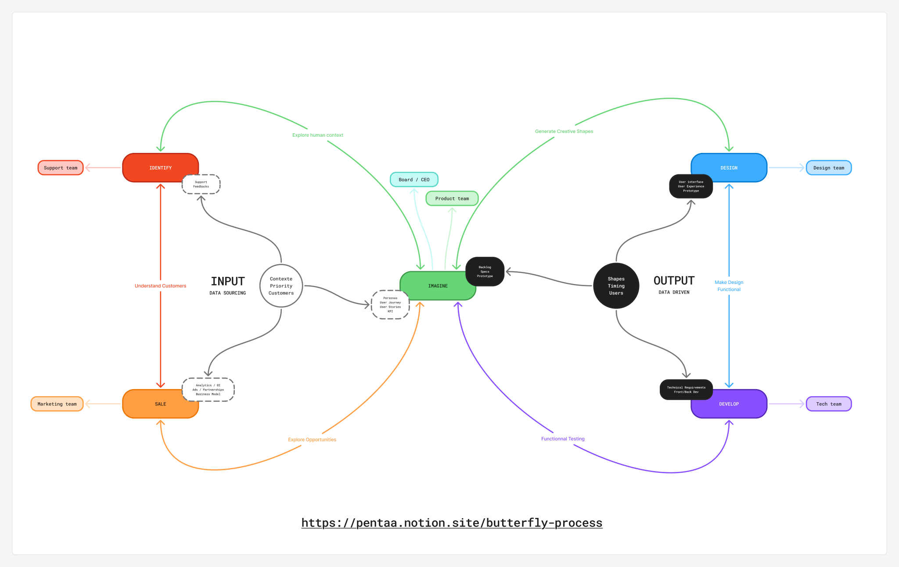

# 🦋 Butterfly Process

> Canonical methodology document for the Product Architect repository (French).
> Content synced verbatim from Notion. Do not paraphrase in agent outputs when citing this document.
> English version: [BUTTERFLY-PROCESS.en.md](./BUTTERFLY-PROCESS.en.md)

## Pourquoi ce récit ?
Je m’appelle Benjamin Arthuys, cela fait près de quinze ans que je travaille sur ce processus. Au départ, ce n’était qu’une intuition : celle d’un design plus large, plus vivant, plus organique que ce qu’on me proposait. J’ai commencé à poser les premières briques de ce qui allait devenir le *Butterfly Process* dans les startups où j’étais fondateur ou en poste de management. Très vite, j’ai compris qu’il ne s’agissait pas simplement d’une méthode de conception produit, mais d’un véritable fil conducteur pour penser, aligner et faire évoluer une organisation entière.
Année après année, j’ai façonné cette méthode au contact du réel. Je l’ai testée, cassée, recomposée. Elle a survécu à des échecs, s’est affinée lors de réussites, et s’est enrichie à chaque nouvelle équipe, chaque nouveau secteur : immobilier, blockchain, RH, musique, jeu vidéo, éducation… À chaque fois, le Butterfly Process m’a permis de **clarifier les situations complexes**, de **réaligner un produit sans repartir de zéro**, de **réduire les frictions et les gaspillages**, et surtout, de faire en sorte que **chaque membre de l’équipe se sente légitime, utile, à la bonne place**.
Aujourd’hui, je sens que le moment est venu de transmettre. Non pas une vérité figée, mais un processus vivant. Un cadre souple, adaptable, qui aide les équipes à mieux collaborer, et les individus à **trouver leur singularité** dans une aventure collective. Ce livre est autant un acte de partage qu’un moment de recul pour moi même.
L’envie de poser les choses. De rendre hommage à tout ce que cette méthode m’a permis de traverser et de construire. Et peut-être, de t’aider toi aussi, lecteur ou lectrice, à créer avec plus de sens, de clarté et de justesse.
## Une méthode née du terrain
Le Butterfly Process n’est pas né dans une salle de formation, ni dans un livre. Il est né sur le terrain, à Barcelone, en 2012. À l’époque, je découvrais le design thinking à travers les cours en ligne de Stanford. Enthousiasmé par cette approche centrée sur l’humain, j’ai voulu l’appliquer immédiatement dans mon rôle de manager. Je dirigeais alors une petite équipe pluridisciplinaire, un designer, un développeur, un success manager, un community manager, avec laquelle nous développions nos propres applications mobiles iOS.
Très vite, j’ai compris qu’il ne suffisait pas de reproduire la méthode à la lettre. L’efficacité du Design Thinking dans une unité produit ne se transposait pas parfaitement à une équipe complète, avec ses interactions humaines, ses contraintes business, ses rythmes de travail. J’ai donc commencé à adapter, tester, transformer. Sans le savoir, je posais les premières briques de ce qui allait devenir, quelques années plus tard, le *Butterfly Process*.
Puis en 2016, j’ai rejoint deux fondateurs dans le lancement d’un outil SaaS pour la gestion de copropriétés. Là encore, j’ai naturellement remis en place ma méthode, avec les ajustements qu’exigeaient cette nouvelle équipe, ce nouveau marché. Le projet s’est structuré : levée de fonds, recrutements, croissance rapide… Et avec chaque changement, j’ai affiné la méthode. J’ai pris note des points de friction, des écueils, des besoins non couverts par les méthodes classiques.
Ce qui était d’abord un process orienté *product design* s’est transformé en une approche plus globale, plus systémique. J’ai peu à peu élargi la méthode à l’ensemble de l’organisation : sales, support, marketing, RH… Parce qu’un produit ne se construit pas uniquement entre designers et développeurs. Il se façonne avec chaque voix, chaque tension, chaque besoin qui traverse une équipe.
Le Butterfly Process est donc né du terrain, dans la friction et l’itération, comme tout bon produit. Il s’est développé au contact de contextes très différents, de personnalités diverses, d’objectifs parfois divergents. Et c’est justement cette **variabilité** qui m’a poussé à le rendre **agnostique**, **adaptable** et **profondément collectif**.
## À qui s’adresse le Butterfly Process ?
Le Butterfly Process s’adresse à toutes les personnes qui souhaitent **lancer un projet**, **créer leur startup** ou **structurer une équipe autour d’un produit**.
Il est particulièrement adapté aux **petites équipes**, aux **fondateurs**, **product managers**, **heads of product**, **CPOs**, ou encore aux profils en **position de management** qui cherchent à mettre en place des processus clairs, fluides et efficaces.
Il s’applique dès la phase d’**idéation**, mais peut aussi être utilisé sur des **projets déjà lancés**, pour retrouver de la clarté, réaligner l’équipe et réancrer le produit dans la réalité utilisateur. Même dans des contextes de **scale-up**, le Butterfly Process peut être un outil puissant lorsqu’il est utilisé sur des **équipes ciblées** et centrées sur un produit spécifique.
Ce process répond aux problématiques fréquentes des startups en croissance :
- Manque de clarté sur les rôles et les responsabilités
- Absence de synchronisation entre les équipes produit, tech, design, sales ou support
- Difficulté à structurer l’itération produit
- Communication fragmentée ou inefficace
- Vélocité sans direction claire
Il s’adresse à celles et ceux qui sentent que **quelque chose ne tourne pas rond dans l’organisation**, mais qui ne savent pas toujours où commencer pour remettre de la cohérence.
Le Butterfly Process propose une **approche structurante mais vivante**, qui remet du sens dans l’action collective. Il aide chaque équipe à mieux **se situer dans le cycle produit**, à savoir **quoi faire, quand, avec qui, et pourquoi**, tout en confrontant rapidement les idées aux utilisateurs pour itérer avec justesse.
## **Comment l’utiliser : lecture linéaire ou navigation modulaire ?**
Cet eBook n’est pas un manuel figé, ni un process à suivre pas à pas comme une recette. Le ***Butterfly Process*** est un cadre vivant, un compagnon de réflexion et d’action. Et comme tout compagnon, il s’adapte à ton rythme, à tes besoins, à ton contexte.
### **Deux manières de l’explorer**
Tu peux l’aborder de deux façons principales :
### **1. Lecture linéaire**
C’est l’approche la plus naturelle : tu lis l’eBook du début à la fin, en suivant l’ordre des chapitres. Cela te permet de :
- Comprendre la philosophie du Process
- Vivre l’évolution logique des étapes : de l’intuition à l’incarnation, de l’idée à l’équipe
- T’immerger dans une progression cohérente, pensée comme une transformation
Cette approche est particulièrement recommandée si tu découvres le Process pour la première fois, ou si tu traverses une phase de création encore floue.
### **2. Navigation modulaire**
Tu peux aussi lire cet eBook comme un **outil de navigation libre**, en piochant dans les chapitres selon ce qui t’appelle ou ce dont tu as besoin maintenant :
- Tu es en train de préparer un prototype ? Va directement au chapitre 4.
- Tu cherches à mieux capter les signaux du terrain ? Replonge dans le chapitre 2 sur l’empathie.
- Ton équipe est désalignée ? Ouvre le chapitre 8.
- Tu veux t’en servir pour un coaching ou une transition personnelle ? File au chapitre 9.
Chaque chapitre a été conçu pour exister en autonomie, tout en s’inscrivant dans une logique d’ensemble. Tu peux donc y revenir, y circuler, les relire à différents moments de ton projet ou de ta pratique.
### **Le Process comme spirale**
Tu verras aussi qu’en avançant, certains chapitres résonneront différemment. Parce que **le Butterfly Process est cyclique** : il n’y a pas un début et une fin, mais des boucles, des retours, des allers-retours entre sens et action, intuition et incarnation.
C’est pour cela que tu peux lire ce livre **plusieurs fois, à différents niveaux**, comme on revisite une carte avec plus de précision à chaque nouveau voyage.
### **Ton livre, ton usage**
Tu peux surligner, annoter, découper, t’approprier chaque page. Tu peux aussi le transmettre à d’autres membres de ton équipe, à un coach, à une personne en transition.
Ce n’est pas un livre à comprendre, c’est un livre à vivre.
# **Chapitre 0 - L’œuf invisible**

## **Quand tout commence dans le flou**
> *Minuscule, presque invisible sur la feuille, l’œuf renferme pourtant toute la promesse de la vie. À ce stade, rien ne bouge, mais tout est déjà écrit : la matière brute, l’ADN, le plan invisible qui guidera chaque étape. C’est l’instant de silence avant l’impulsion.*
Avant l’idée, il y a l’intuition. Avant le plan, une vibration. Et avant toute structure, un espace libre.
Un entre-deux sacré. Un néant vivant. Un **cocon invisible**.
C’est dans ce moment suspendu, où rien n’est encore là, mais où tout frémit, que le projet commence à s’écrire.
Pas sur un tableau blanc. Mais dans une **matière intérieure** mouvante, subtile, souvent déroutante.
Ce flou n’est pas une erreur. C’est **un terrain de jeu**.
> 💭 Picasso parlait de ses silences comme des temps de digestion. Il laissait parfois l’inspiration le fuir pour mieux la retrouver. Créer, pour lui, c’était aussi attendre.
> 💭 	*(Inspiré de ses propos rapportés dans les carnets de Françoise Gilot, “Vivre avec Picasso”, 1964)*
## **Le territoire de l’intuition**
Tu n’as encore aucune contrainte. Aucune cible. Aucune logique.
C’est justement pour cela que ce moment est précieux :
> Tu peux **projeter mille futurs sans te soucier de leur faisabilité. **Tu peux **dessiner avec ton cœur, pas avec ta tête. **Tu peux **inventer sans permission.**
Car l’idée juste, celle qui va traverser les tempêtes, inspirer les autres, résister au doute, ne naît jamais d’une stratégie.
Elle **émerge d’un frisson.** D’un désir qui t’appelle. D’un éclat d’émotion.
Souvent incompréhensible au début, mais terriblement vivant.
> 💭 Einstein passait des heures à rêver éveillé. Ses équations venaient souvent après une longue errance mentale. Il disait que “l’imagination est plus importante que le savoir”.
> 💭 	*(Discours à l’Académie des sciences de Berlin, 1931 ; repris dans “Cosmic Religion”, 1939)*
## **Dissolution créative**
Lorsque la chenille entre en métamorphose, elle ne se renforce pas.
Elle **s’abandonne.** Son corps se dissout. Elle devient liquide, informe, vulnérable.
Et dans ce chaos biologique, de **minuscules cellules appelées imaginaux** s’activent.
Elles contiennent en silence le plan du papillon à venir.
Elles savent.
> Il en va de même pour un projet.
Avant qu’il ne prenne forme, il traverse ce moment de **perte apparente**.
De doute. De remise à zéro.
C’est là, dans ce non-savoir, que se nichent les germes les plus puissants.
## **Résister à l’envie de cadrer**
Dans notre monde obsédé par l’action, on voudrait vite :
- définir une cible
- poser un MVP
- tester un problème
- construire un business model
Mais ici, dans ce cocon, ces réflexes sont des pièges.
Ils **étouffent la vibration** au lieu de la laisser se déployer.
Laisse ton projet **se rêver avant de vouloir le rationaliser.**
Laisse l’image émerger **avant de la figer.**
> *Le cadre viendra. Mais plus tard. Pour l’instant, tu es dans la nuit féconde avant l’aube.*
## **Les peurs qui surgissent**
Cette phase peut être inconfortable. Elle ravive des tensions familières :
- **La peur du vide** : “Je ne sais pas où je vais…”
- **Le besoin de contrôle** : “Je dois avancer, vite.”
- **La crainte de l’irrationnel** : “Ce n’est pas assez concret pour être sérieux.”
Mais si tu les acceptes comme les gardiens du passage, elles deviennent des **alliées initiatiques.**
Elles t’invitent à traverser, pas à fuir.
> 💭 Bowie disparaissait entre deux albums pour redevenir “personne”. Ce vide identitaire lui permettait de renaître sous une nouvelle forme. Le flou, chez lui, était une matrice.
> 💭 	*(Interview dans le documentaire “Cracked Actor”, BBC, 1975 ; et “David Bowie: A Life” par Dylan Jones, 2017)*
## **Rituel : Le Journal des Imaginaux**
Tu peux créer un espace, physique ou numérique, où tu vas déposer sans filtre :
- ce qui te traverse (images, sensations, rêves, agacements)
- ce qui revient en boucle
- ce qui déclenche une émotion inattendue
- ce que ton corps ressent sans que tu comprennes pourquoi
C’est ton **journal des imaginaux**.
Un sanctuaire d’étincelles.
Un compost de l’invisible.
Tu n’as rien à trier. Rien à valider.
Juste à **recueillir**.
> *Comme un photographe dans le brouillard, tu captes des formes à peine perceptibles. Tu les développes plus tard. Mais pour l’instant, tu observes.*
## **Le cocon est déjà une forme**
Ce chapitre n’est pas un simple préambule.
Il est **le vrai début du Process.**
Le plus silencieux. Le plus insaisissable. Mais aussi le plus sacré.
C’est ici que **tu redeviens vivant avec ton projet.**
Avant les outils. Avant les sprints. Avant les livrables.
Et si tu écoutes bien…
Tu verras que **tu es déjà en train de devenir.**
## **Résumé en 5 points**
- Le flou initial est **un passage fondateur**, pas un défaut à corriger.
- C’est un temps de **lâcher-prise radical**, où l’imagination est reine.
- La **métaphore du cocon** illustre la transformation intérieure nécessaire.
- Les **signaux faibles** sont les imaginaux : frissons, obsessions, résonances.
- Le meilleur outil ici : **l’écoute sensible et le journal libre.**
# **Chapitre 1 - Les imaginaux : reconnaître les signaux faibles**

## L’apparition des formes
> *« Ce que tu cherches te cherche déjà. »*
Lorsque la chenille entre en dissolution, certaines cellules ne se contentent pas de disparaître. Au contraire, elles s'activent. On les appelle les cellules imaginatives, ou *cellules imaginaux*. Ce sont elles qui contiennent le plan caché du papillon à venir. Elles portent en elles l'information du futur, alors même que l'ancien corps est en train de se liquéfier.
Dans un projet, c'est exactement la même chose. Avant que l'idée ne soit claire, avant que le produit n'existe, il y a des signes, des éclats, des intuitions fugaces. Ce sont les imaginaux du projet. Des phrases qui nous obsèdent. Des images qui reviennent en boucle. Des agacements persistants. Des émotions vives et répétées face à une situation donnée. Ce ne sont pas encore des idées construites, ce ne sont pas encore des objectifs, ce ne sont pas même des intentions conscientes. Mais ils sont là. Et ils résonnent. Ils appellent. Ils murmurent quelque chose.
> 💭 Virginia Woolf notait ses idées au fil de l’intuition, sans structure, avant que n’émerge l’architecture de ses romans
> 💭 	*citation tirée de “A Writer’s Diary”*
Reconnaître ces signaux faibles, c'est reconnaître en soi les premières expressions d'un futur possible. C'est admettre que quelque chose cherche à naître à travers nous, même si nous ne savons pas encore exactement quoi. Ce sont des fragments de sens, des éclats d'envie, des générations spontanées d'énergie.
La plupart du temps, on les rejette. On les classe comme des distractions, des lubies, des pertes de temps. Mais dans le Butterfly Process, on apprend à les accueillir. On leur donne une place. On comprend que c'est justement dans ces signaux faibles que se trouve le germe de l'idée forte. L'imaginal est toujours présent avant la structure. Il précède la logique.
Le corps est souvent le premier à réagir. Une légèreté soudaine, un frisson, un feu dans le ventre, une tension dans la nuque. Ces réactions sont des messages. Il en va de même pour les émotions : une colère récurrente face à une injustice perçue, une tristesse inexplicable face à un sujet, ou au contraire une joie vive à l'évocation d'une expérience. Tous ces mouvements intérieurs sont des portes. Ils mènent vers des territoires que l'esprit n'a pas encore explorés consciemment.
Les imaginaux se manifestent aussi dans les répétitions. Ce livre qu'on croise trois fois en une semaine. Cette conversation qu'on entend par hasard mais qui touche juste. Ce mot qui revient encore et encore dans notre esprit. Ces motifs ne sont pas le fruit du hasard : ils sont des balises. Ils signalent des croisements, des intersections où le passé, le présent et l'avenir s'entrechoquent.
Ce chapitre est une invitation à l'écoute profonde. Pas une écoute mentale, mais une écoute sensible. Il ne s'agit pas ici de comprendre, mais de sentir. D'observer. De noter. Sans chercher à trier, à analyser, à juger. Il s'agit de collecter. De faire confiance. De se laisser traverser.
Pendant cette phase, ton seul travail est d'être réceptif. Laisse venir les images, les désirs, les intuitions, les inconforts. Laisse-les se déployer sans pression. C'est à partir d'eux que tu pourras, dans les prochains chapitres, formuler une intention claire, poser un cadre, et commencer à construire. Mais pour l'instant, sois le jardinier du flou. Le cueilleur d'étincelles. Le cartographe de tes propres signaux faibles.
Les imaginaux sont les graines invisibles d'un futur déjà en gestation. Tu n'as pas à les comprendre tout de suite. Tu dois simplement leur faire une place.
## Du signal à l’image
Ce qui d’abord n’est qu’un battement irrégulier, un reflet fugace, devient parfois plus tangible. Tu peux remarquer que certains imaginaux insistent. Ils commencent à se regrouper, à créer des liens entre eux. Une phrase que tu avais notée il y a un mois résonne soudain avec une idée venue en marchant ce matin. Une question qui t’obsède trouve un écho dans une discussion surprise dans un café.
> 💭 Brian Eno laissait volontairement des phrases ou sons tourner dans son studio, pour capter ce qui insistait.
> 💭 	*“Oblique Strategies” (1975)*
C’est là que l’on passe d’un signal faible à un archipel de sens. Les premiers contours de l’idée apparaissent. Elle n’a pas encore de forme claire, mais elle vibre. Elle demande ton attention. Et surtout, elle demande un espace pour être nourrie.
Tu peux commencer à faire des associations. Relier des mots, des images, des souvenirs, des problèmes, des envies. C’est une cartographie vivante. Un espace poétique et ouvert où tu n’as pas besoin d’être cohérent. Tu dois suivre le fil de l’excitation. Créer du lien. Jouer.
## Laisser vivre avant de cadrer
L’erreur classique, dans les premières étapes de conception d’un projet, c’est de vouloir cadrer trop vite. Trouver le nom, définir la cible, prévoir un business model. Mais un imaginal préfère l’air libre à la cage de la précision prématurée.
Ce chapitre t’invite à te déshabituer des automatismes de productivité. Ici, on n’avance pas pour aller vite. On avance pour aller profond. Chaque note, chaque intuition, chaque récurrence est une source potentielle d’inspiration à venir. Laisse-les prendre place. Tu n’es pas là pour valider. Tu es là pour accueillir.
> 💭 Kandinsky voyait des formes avant de savoir ce qu’elles représentaient. Il peignait à partir d’une résonance sonore ou émotionnelle. 
> 💭 	*tiré de “Du spirituel dans l’art”, 1911*
## Le journal des intuitions
Ce que je recommande, c’est d’ouvrir un espace physique ou numérique que tu appelleras ton "journal des intuitions". C’est un espace sans filtre, sans obligation de résultat. Tu y notes chaque chose qui fait écho. Chaque sensation qui te trouble. Chaque élément qui crée une résonance.
Ce journal est la base de ton dialogue avec les imaginaux. Il peut être poétique, brouillon, discontinu. Mais il sera un miroir. Et plus tu t’y connecteras, plus les formes se préciseront. Le Butterfly Process commence ici : dans ce va-et-vient entre le trouble fertile et la structure à venir.
## Conclusion temporaire
Ce n’est pas encore le moment de poser une définition. Mais tu peux sentir que quelque chose a commencé. Ce chapitre est là pour honorer l’invisible, le non-verbal, le naissant. Les imaginaux sont les messagers du projet à venir. Ne les brusque pas. Ne les maîtris pas. Sois le témoin attentif de leur éveil.
# **Chapitre 2 - Empathie radicale**

## **L’intuition cherche son miroir**
> « Le plus court chemin vers soi passe souvent par l’autre. »
Tu as commencé à capter les premiers signaux faibles. Des émotions. Des tensions. Des élans. Tu tiens entre les mains une forme embryonnaire de projet. Une vibration intérieure. Mais à ce stade, elle est encore solitaire, enfermée dans ton univers subjectif.
L’étape qui vient est celle de la rencontre. Celle où ton idée sort de toi pour aller frôler l’expérience d’autrui. Et c’est une étape cruciale : une idée qui ne se laisse pas traverser par l’altérité risque de tourner à vide.
Le Butterfly Process t’invite ici à une **empathie radicale**, c’est-à-dire une qualité de présence rare, vulnérable, réceptive, qui va bien au-delà d’une étude d’audience ou d’un persona marketing.
## **Ce que signifie vraiment écouter**
> 💭 “L’écoute profonde est un acte de révolution silencieuse.” : bell hooks
Écouter dans le cadre du Butterfly Process, ce n’est pas chercher à confirmer une hypothèse. C’est **se laisser transformer** par la réalité de l’autre. C’est approcher le terrain non pas comme un marché, mais comme une humanité. C’est venir **sans filtre, sans agenda, sans stratégie préétablie.**
Cela suppose un désarmement intérieur. Une suspension des certitudes. Un art d’accueillir la parole, le silence, les contradictions, les non-dits.
Il ne s’agit pas de trouver « ce que veulent les gens », mais de percevoir **ce qui les traverse.**
> *Tu ne viens pas chercher une réponse, tu viens chercher une rencontre.*
Dans le Butterfly Process, on ne vient pas avec un questionnaire qui dirige la personne dans un sens ou qui vient confirmer des hypothèses que l’on aurait établies au préalables. Ce qu’on vient chercher ce sont des hypothèses auxquelles on aurait jamais pensé seules et qui peuvent même être contre intuitives. Donc on peut arriver dans un entretien avec une trame, un fil conducteur qui nous aide à rester dans le sujet, cependant on laisse la possibilité à la personne d’aller dans le sens qu’elle veut.
**Un exemple concret :** *Lors d’un entretien utilisateur pour comprendre comment améliorer une fonctionnalité de recherche dans une application de gestion documentaire, j’étais parti avec l’hypothèse que les utilisateurs voulaient plus de filtres, un moteur plus rapide, ou une interface plus claire.*
*Mais en laissant la personne parler librement, elle a évoqué autre chose : “Je ne sais jamais comment formuler ce que je cherche. J’ai l’impression que je dois penser comme l’outil pour qu’il me comprenne.”*
*Cette phrase a été un basculement. Elle révélait une tension bien plus profonde que celle d’un mauvais moteur de recherche : le sentiment de devoir s’adapter à la logique de l’outil, plutôt que l’inverse.*
*L’enjeu n’était pas technique, mais cognitif et émotionnel : repenser le design pour qu’il accompagne la formulation floue, imparfaite, humaine de la demande. Ce que j’avais pris pour un problème d’algorithme était en réalité une question de posture, d’empathie, et de dialogue entre humain et interface.*
## **Techniques d’empathie sensible**
Voici quelques approches que tu peux mettre en œuvre dans cet esprit :
### **Les entretiens ouverts**
Tu poses des questions ouvertes, tu laisses les gens parler librement. Tu creuses les émotions, les métaphores, les contradictions. Ce n’est pas un questionnaire. C’est une conversation.
### **L’observation passive**
Tu regardes. Tu notes. Tu te fonds dans le décor. Tu observes les gestes, les hésitations, les détours, les raccourcis. Tu regardes ce que les gens font réellement, pas ce qu’ils disent faire.
### **L’immersion**
Tu vis toi-même ce que ton utilisateur potentiel vit : tu passes une journée dans un service client, tu t’inscris à un atelier, tu utilises un produit concurrent. Tu sens dans ton corps les blocages, les facilités, les absurdités.
### **Le journal de terrain**
Tu prends des notes chaque jour sur les comportements, les signaux faibles, les intuitions qui surgissent dans la relation au terrain. Tu croises les regards. Tu laisses les motifs apparaître.
### **Ce que tu dois capter**
Ce que tu recherches à ce stade, ce sont **des tensions humaines**. Des choses qui coincent. Qui blessent. Qui créent des efforts invisibles. Ou au contraire, des choses qui fluidifient, qui émerveillent, qui réconcilient.
Cherche à voir :
- Où ça frotte ?
- Où les gens compensent ?
- Où ils mentent pour tenir ?
- Où ils trichent avec eux-mêmes ?
- Où ils s’adaptent au lieu d’être eux ?
Et note aussi :
- Ce qui les fait sourire sans s’en rendre compte.
- Ce qu’ils répètent sans y penser.
- Ce qu’ils n’osent pas demander.
Ce sont ces endroits-là qui contiennent **la vraie matière du design.**
### **L’écoute n’est pas neutre**
Il faut aussi le dire clairement : **écouter est un acte politique.** C’est choisir de ne pas imposer sa vision. C’est reconnaître que l’autre détient une part de vérité essentielle. C’est parfois désapprendre ce que tu croyais savoir.
Tu peux être bousculé par les récits, confronté à des réalités que tu ignorais, ému par une parole qui te déplace. C’est normal. C’est même le signe que tu es au bon endroit.
> *L’empathie ne consiste pas à comprendre l’autre comme un objet à analyser, mais à le ressentir comme un sujet qui t’affecte.*
## **Revenir transformé**
L’objectif de cette phase n’est pas de produire un rapport, mais de **changer ton regard.**
À la fin de ton exploration empathique, tu ne dois pas seulement avoir des verbatims. Tu dois **te sentir déplacé, concerné, traversé**. Si ce n’est pas le cas, tu as peut-être écouté trop vite ou trop en surface.
C’est à ce moment-là que tu peux commencer à **formuler une tension**. Pas une solution. Pas une feature. Une tension. Un écart douloureux entre ce qui est et ce qui pourrait être. C’est cette tension qui va te guider ensuite dans la phase de définition.
## **Les pièges à éviter**
- **Écouter pour valider ce que tu pensais déjà.**
	Tu n’es pas là pour confirmer ton idée. Tu es là pour la remettre en jeu.
- **Transformer trop vite les insights en idées de business.**
	Laisse les tensions se déposer. Ne cherche pas à tout monétiser. D’abord ressentir, ensuite construire.
- **Confondre empathie et projection.**
	Tu n’es pas ton utilisateur. Même si tu as vécu des choses similaires. Apprends à rester à ta place tout en étant poreux.
## **Rituel de clôture : écrire la tension**
À la fin de cette phase, offre-toi un moment de calme et réponds à cette question :
> *Quelle est la tension principale que j’ai ressentie dans cette rencontre avec l’autre ?*
Formule-la avec des mots simples. Sans jargon. En une phrase. Elle sera la boussole du chapitre suivant.
Souviens-toi : **Tu ne construis pas pour les gens. Tu construis avec eux.**
Et c’est dans cet espace de co-sensation, de co-perception, que les projets justes prennent racine.
# **Chapitre 3 - Définition claire et intentionnelle**

## Du chaos d'information à l'émergence du sens
Après avoir plongé dans le réel, observé, écouté, ressenti, te voilà face à une masse d’informations vivantes. Des témoignages, des gestes, des douleurs, des élans. Si l’étape précédente t’a permis de te connecter aux autres, celle-ci va te permettre de formuler un **point de tension clair** à partir de ce que tu as capté.
> 💭 *Richard Sennett parle de “résistance fertile” : cette tension entre ce que tu veux faire et la matière avec laquelle tu le fais. C’est là que réside la créativité profonde.*
Définir n’est pas cadrer brutalement. C’est **extraire un noyau de clarté**, sans perdre la richesse de l’exploration. C’est nommer ce qui résiste, ce qui revient, ce qui fait mal, ce qui fait sens. C’est identifier une fracture, une faille, un manque, et le transformer en **boussole pour l’action**.
## Formuler une tension, pas une solution
Une erreur fréquente consiste à formuler tout de suite une solution. Mais ce n’est pas encore le moment. Ce que tu veux maintenant, c’est **cerner le vrai problème**. Et pour cela, il faut oser rester un peu dans le flou. Tu as récolté des signaux, maintenant tu vas les croiser, les regrouper, les interpréter sans les figer.
Pose-toi les bonnes questions :
- Qu’est-ce qui revient le plus souvent ?
- Qu’est-ce qui provoque de l’émotion ?
- Où sont les contradictions ? Les inconforts ?
Et surtout : **qu’est-ce que ça dit de plus profond ?**
Zoom ou recul ? Parfois, ce que tu identifie comme une tension est un symptôme local, mais pas encore la racine.
*Exemple : “L’utilisateur ne trouve pas l’option pour modifier son profil.”* - Est-ce un problème de placement du bouton ? - Ou bien une confusion plus large sur la logique de navigation ? - Ou encore un manque de repère dans tout le parcours ?
Pose-toi la question : Est-ce que je suis face à une tension de surface ou une faille structurelle ?
C’est ça aussi, l’art de définir : savoir quand zoomer et quand recadrer.
## L’art de poser une bonne problématique
Dans cette phase, tu n’es pas en train de décrire un problème : tu es en train de le construire à partir de ta lecture du terrain. C’est une compétence en soi, une manière d’orienter le réel. Une bonne problématique est vivante. Elle ne ferme pas, elle ouvre. Elle est assez précise pour guider, assez ouverte pour permettre l’émergence de solutions variées.
> 💭 “Poser une problématique est déjà un acte de conception.” : Donald Schön, The Reflective Practitioner
### Quelques formulations pièges, à éviter :
- *Comment pourrions-nous “ajouter une fonctionnalité de filtres avancés” ?* → C’est déjà une solution, pas une tension.
- *Comment améliorer notre produit pour que les utilisateurs s’y retrouvent mieux ? *→ Trop vague, trop général, sans point d’accroche.
- *Comment convaincre nos utilisateurs d’utiliser la fonctionnalité X ?* → Cela part d’un biais : le problème est peut-être que la fonctionnalité ne répond pas à une tension réelle.
Une bonne formulation laisse de la place à l’inconnu. Elle ne suppose pas la réponse. Elle invite à explorer. Tu peux t’appuyer sur le format bien connu du Design Thinking :
### **“Comment pourrions-nous… ?”** (*How Might We…*)
> 💭 Ce type de formulation, “How might we…”, a été popularisé par IDEO, notamment par Tim Brown. Mais ici, on ne l’utilise pas comme une méthode à appliquer mécaniquement. C’est une invitation ouverte, un cadre poétique pour explorer la suite sans enfermer la pensée.
**Par exemple :**
- Comment pourrions-nous réduire la solitude dans les processus de création ?
- Comment pourrions-nous reconnecter les gens à leurs intuitions ?
- Comment pourrions-nous simplifier la prise de décision collective ?
Ce type de question n’est pas anodin. Il guide tout ce qui va suivre.
## Synthèse, priorisation, alignement
Attention à ce que tu crois voir. En phase de synthèse, on a tendance à privilégier ce qui nous arrange : ce qu’on comprend facilement, ce qui conforte notre intuition de départ. Mais attention, certains besoins sont masqués par des biais collectifs ou culturels.
*Exemple : Un outil mal utilisé n’est pas toujours mal conçu. Il peut être mal introduit, mal valorisé socialement, ou rejeté à cause d’un inconfort tacite dans l’équipe.*
Apprends à voir au-delà de la surface. Regarde les dynamiques relationnelles, les silences, les détours. Ce sont souvent eux qui te mettent sur la vraie piste.
Tu peux maintenant créer une **synthèse visuelle** de ton exploration : cartographie des enjeux, tri des verbatims, regroupement des besoins. Priorise ce qui revient avec le plus d’intensité. Et vérifie si ce que tu ressens est partagé par les autres membres de ton équipe. C’est le moment d’**aligner les visions**.
Tu n’as pas besoin d’un consensus total, mais d’une tension suffisamment partagée pour justifier une action. Et d’un cadre suffisamment clair pour éviter de te perdre dans la suite du processus.
## Un cadre mouvant
Ce que tu vas poser ici, ce n’est pas une vérité absolue. C’est un **cadre temporaire**. Une boussole, pas une prison. Tu vas le challenger, l’affiner, le revoir. Mais pour avancer, il te faut cette première formulation. Cette colonne vertébrale sur laquelle tu vas pouvoir commencer à construire.
Le prochain chapitre marquera le passage à l’action : **rendre visible ce que tu ressens, ce que tu as compris, ce que tu veux tester**. Ce sera le moment de prototyper.
## **📌 **Résumé en 5 points
- La définition d’un projet commence par une tension, pas une solution.
- Une bonne problématique est à la fois ouverte et incarnée.
- Le cadre posé est temporaire, il sert de boussole, pas de cage.
- La clarté vient en traversant les contradictions, pas en les éliminant.
- Cette étape est la colonne vertébrale du cycle qui va suivre.
# **Chapitre 4 - Prototypage vivant**

> 💡 *“Fail faster to succeed sooner” -* David Kelley
## Donner corps à une intention sans l'enfermer
Tu as traversé l'intuition, rencontré le réel, formulé une tension. Tu tiens maintenant entre les mains une intention claire, un besoin ressenti, une problématique vivante. Le moment est venu de **l’incarner**.
Mais attention : il ne s’agit pas encore de construire un produit final. Il s’agit d’**esquisser**, de matérialiser juste assez pour apprendre. Le prototype n’est pas une promesse. C’est une **hypothèse rendue tangible**.
Le prototypage est au cœur du Butterfly Process parce qu’il permet d’explorer sans s’enfermer. Il rend visible une idée, la confronte, la fait vivre. Il ne cherche pas à être parfait. Il cherche à **être utile à l'apprentissage**.
## Prototyper, c'est dialoguer avec le réel
Un prototype n’est pas seulement un objet ou un écran. C’est une **expérience**. Une manière de faire entrer l’autre dans ton univers. Une invitation à interagir, à réagir, à co-construire.
Prototyper, c’est ouvrir la discussion. C’est demander au monde : *“Et si c’était comme ça ?”* Et écouter ce que le monde te répond.
Cela peut être :
- Un dessin rapide sur papier
- Une landing page fictive
- Un scénario joué
- Un storyboard
- Un faux email
- Un jeu de rôle
- Une interface cliquable
Et parfois, le prototype n’est pas un objet visuel mais un **support émotionnel ou symbolique. **Une lettre fictive, une carte mentale imprimée, un message audio improvisé : tout ce qui donne une première existence à ton intention peut devenir un prototype.
> *“Prototyping as a tool of empathy” - *Liz Sanders
👉 Ce qui compte, ce n’est pas la forme, mais la possibilité de réagir.
L’important n’est pas le médium, mais le message. Et surtout, la possibilité pour ton interlocuteur de réagir, d’interagir, de te montrer ce que tu n’avais pas vu.
Attention toutefois : **si tu ne poses pas l’intention de ton prototype, tu risques de biaiser la réaction. **Avant de montrer, prends 10 secondes pour dire :
*“Ceci n’est pas une solution aboutie, mais une hypothèse que je teste. J’aimerais savoir ce que ça éveille chez toi.”*
Ce simple rituel libère la parole, et évite que ton interlocuteur se bloque sur la finition ou la faisabilité.
## Tester le contexte, pas seulement le produit
Une erreur fréquente dans les phases de prototypage est de ne tester que la forme visible du produit : l’interface, les mots, les visuels. Or, **ton produit va s'insérer dans un écosystème beaucoup plus large** : business model, attentes du marché, partenariats stratégiques, timing de déploiement, modèle économique.
C’est pourquoi il est essentiel de **prototyper également le contexte** :
- Tester un pricing avec une landing page + pub ciblée
- Simuler un partenariat en co-brandant un premier contenu
- Jouer une simulation de pitch avec un investisseur
- Afficher une promesse produit pour voir qui clique, qui s’inscrit, qui partage
- Créer un MVP de ton écosystème avant même le MVP technique
- **Créer un faux groupe Slack ou Discord** autour du projet, et voir si des personnes choisissent spontanément d’y rester actives : c’est une manière simple de tester l’appétence pour une communauté avant même d’avoir un produit fini.
Le but ici est de comprendre si ton projet est **non seulement désirable** pour les utilisateurs, mais aussi **viable** pour ton business. De nombreux projets techniquement brillants échouent faute d’avoir validé leur ancrage dans le monde réel.
## Apprendre vite, ajuster souvent
Le prototype est au service de l’**itération rapide**. Tu ne fais pas un prototype pour convaincre. Tu fais un prototype pour apprendre.
Mais attention : **un prototype trop “pro” peut te tromper. **Si ton design est déjà très lisse, très abouti, ton interlocuteur n’osera pas critiquer. Il jugera l’esthétique au lieu de pointer la tension. Reste volontairement **imparfait **: un croquis, une maquette bancale, un scénario mal joué. C’est dans cette fragilité que tu obtiendras les retours les plus sincères. Pour découvrir ce que tu avais mal compris, ce que tu n’avais pas vu, ce qui résonne vraiment.
Plus tu prototyperas tôt, plus tu découvriras vite ce qui est essentiel. Tu vas économiser du temps, de l’énergie, de la frustration. Tu vas surtout **développer une intelligence du feedback**. Car un bon prototype ne te dit pas seulement si une idée est bonne : il te montre **comment elle est perçue**.
## La boucle continue
Dans le Butterfly Process, le prototypage est un **mouvement permanent**. Ce n’est pas une étape unique. C’est une boucle. On prototype, on teste, on apprend, on réajuste, on re-prototype.
Ce chapitre t’invite à créer dans la matière, à sortir du mental, à donner forme à tes intuitions. Même si c’est moche. Même si ce n’est pas fini. Ce qui compte, c’est que **tu commences à donner une existence au projet**.
C’est le moment de faire. De montrer. De poser des formes fragiles mais réelles. Car c’est en voyant une idée se matérialiser qu’on comprend enfin ce qu’elle veut devenir.
Dans le prochain chapitre, nous verrons comment cette matière prend de la cohérence, de l’élégance, et commence à construire une véritable expérience : c’est le temps du design incarné.
# **Chapitre 5 - Design incarné**

> *Le design, ce n’est pas seulement l’apparence, c’est aussi comment ça marche.”* : Steve Jobs
## Du brouillon au vivant
Après avoir esquissé ton idée, l’avoir rendue visible à travers des prototypes, tu entres dans une phase plus fine, plus sensible, presque organique : celle du **design incarné**. Il ne s’agit plus seulement de montrer ou de tester une forme brute, mais de **sculpter une expérience cohérente, alignée, signifiante**.
Le design ici ne se réduit pas à l’esthétique. Il est une **intelligence de la forme au service du fond**. Il donne une cohérence, une fluidité, une émotion à ce que tu veux faire vivre. C’est à ce moment-là que ton projet commence à toucher, à parler, à vibrer pour l’autre.
> 💡 *Un bon design ne cache rien. Il révèle l’intention.*
## Design = Relation
Le design n’est pas un habillage. C’est une **relation construite entre ton intention et l’expérience vécue par l’utilisateur**. Il traduit des choix. Il rend visible des priorités. Il guide, il apaise, il excite, il oriente.
Tu dois te poser des questions profondes :
- Que veux-tu que la personne ressente au contact de ton projet ?
- Quelle posture veux-tu qu’elle adopte ?
- Quelle émotion veux-tu qu’elle garde après coup ?
Exemple : *Voulez-vous que votre utilisateur se sente guidé comme dans un musée, ou libre comme dans une promenade en forêt ?*
Ces questions sont plus importantes que la couleur du bouton. Elles sont le socle sur lequel tu vas concevoir chaque détail.
> 🔍 *Si ton design raconte trop, il fatigue. Si ton design ne raconte rien, il perd.*
## Construire une narration invisible
Un bon design raconte une histoire. Il crée une ambiance. Il installe une cohérence interne. Même s’il est minimal, même s’il est brut. Le design incarné, c’est cette capacité à faire passer un message sans le dire. 
Tu peux le voir comme un **arc narratif** (story arc)** **:
- Une introduction (on accueille)
- Une tension (on guide, on surprend)
- Une résolution (on relâche, on clôture)
Chaque parcours utilisateur est une petite histoire. Chaque détail doit renforcer ce rythme. C’est transmettre une intention à travers l’agencement des éléments, la fluidité du parcours, l’équilibre des volumes, le rythme de l’interaction.
C’est aussi une invitation au respect : respecter le temps, l’attention, la perception de l’autre. Un bon design ne crie pas. Il invite. Il laisse de l’espace.
## Collaboration et émergence
À cette étape, le designer ne travaille pas seul. Il échange avec le produit, le marketing, la technique. Il capte les retours des utilisateurs, il navigue entre les contraintes. Il est à l’écoute du projet, comme on écoute un être vivant qui cherche sa forme.
Le design incarné émerge souvent du **feedback contradictoire** :
- Le marketing pousse pour plus de clarté
- La technique demande plus de simplicité
- Le design cherche plus de cohérence
C’est ce qui le rend puissant : il est **le fruit d’un équilibre fragile entre l’esthétique, la fonction, l’émotion et le contexte**. C’est de cette tension entre sensibilités que naît la justesse.
> ✨ *Le détail n’est jamais anodin. Il est un fragment d’âme.*
## L’alignement final
Quand un design est juste, tout s’aligne. Le sens devient perceptible. L’expérience devient fluide. L’intention devient palpable. C’est ce moment où tu sens que ton idée est en train de se poser dans le monde, non plus comme un concept, mais comme une réalité sensible.
> ⚠️ Attention : un design trop lisse peut tuer l’âme du projet. À force de polir, d’optimiser, d’uniformiser, on gomme la singularité. Il faut savoir préserver la vibration initiale dans la forme finale.
Ce chapitre est un hommage à cette étape souvent négligée, mais pourtant cruciale : celle où l’on donne à voir, à toucher, à ressentir. Celle où l’on honore l’utilisateur en lui offrant une expérience juste.
# **Chapitre 6 - Développement ancré**

## Faire exister sans trahir
Lorsque le design a été affiné, incarné, ressenti, vient l’ultime étape du cycle de matérialisation : le **développement**. C’est ici que ton idée quitte le monde des intentions pour entrer dans la matière. Elle devient **fonctionnelle**, **opérationnelle**, **vivante** dans le réel numérique.
Mais attention : le développement n’est pas une simple exécution technique. Il est un **acte de création à part entière**. Il engage des choix, des compromis, des arbitrages. Et c’est justement parce qu’il est souvent perçu comme une phase rigide ou fermée qu’il est essentiel de le replacer au cœur du processus vivant.
> *“Any fool can write code that a computer can understand. Good programmers write code that humans can understand.” -  *Martin Fowler (architecte logiciel, ThoughtWorks)
## Le code comme artisanat
Un bon développeur n’est pas un robot qui traduit des maquettes en lignes de code. C’est un **artisan de la structure**, un traducteur sensible entre la vision et la réalité technique.
Il prend en compte les contraintes, optimise, ajuste, fait respirer l’interface, décide des logiques d’interactions.
Comme l’écrit Richard Sennett dans *The Craftsman*, l’artisan ne cherche pas seulement à produire, mais à **bien faire pour donner sens à ce qu’il crée**.
Il y a une dignité intrinsèque dans le code propre, lisible, pensé pour durer. Un code bien écrit, bien pensé, bien posé, est invisible pour l’utilisateur. Et pourtant, il conditionne toute l’expérience. Il porte l’intention jusque dans le clic, jusque dans la réactivité, jusque dans la fluidité des transitions.
Exemple : le choix d’optimiser une requête pour éviter une latence imperceptible, ou l’ajout d’une micro-animation qui rend un geste plus intuitif.
Des détails presque invisibles, mais qui transforment la perception globale du produit.
> 💡 *Un code juste est invisible. Il fait oublier sa présence.*
## La boucle produit-tech
Dans un Butterfly Process mature, le dialogue entre l’équipe produit et l’équipe technique est **permanent**. Il ne s’agit pas de livrer un cahier des charges, mais de collaborer au fil des ajustements, dans une boucle vivante.
Le développement ne sert pas seulement à valider des idées. Il peut aussi en remettre en question. C’est une opportunité pour **ancrer le sens dans les limites du faisable**, affiner les priorités, et faire respirer la cohérence. Comme le rappelle Kent Beck, pionnier de l’Extreme Programming : *“Make it work, make it right, make it fast.” *Cette logique incarne parfaitement la boucle produit-tech : on valide une intention, on la clarifie, puis on l’optimise dans un aller-retour constant.
*Exemple : Une équipe voulait intégrer une recherche multi-critères complexe. En échangeant avec les développeurs, ils ont découvert qu’une simple recherche plein texte + filtres progressifs apportait 80 % de la valeur pour 20 % de l’effort.*
La solution technique a redéfini la vision produit, tout en améliorant l’expérience.
👉 C’est pourquoi il faut prévoir de l’espace pour les allers-retours, pour l’itération, pour l’exploration technique.
L’idéal est que les développeurs soient impliqués très tôt dans le process, afin qu’ils comprennent l’**âme du projet**, pas seulement sa surface.
> 🔍 *Ne réduis pas le développement à une exécution. C’est une traduction sensible.*
## L’art de livrer en conscience
La mise en ligne d’un projet n’est pas une fin. C’est un **acte de naissance**. Ce que tu livres au monde va être exploré, testé, jugé, aimé, détourné. Il faut donc livrer avec **responsabilité**.
Prendre soin du code comme on prend soin d’une maison qu’on ouvre. Livrer en conscience, c’est comprendre que le développement ne s’arrête pas à “ça marche”.
C’est anticiper la **dette invisible** :
- une sécurité négligée qui devient une faille,
- une accessibilité oubliée qui exclut des personnes,
- une architecture trop fragile qui bloque la croissance.
👉 Un produit peut sembler fonctionnel, mais s’il est livré sans ces attentions, il porte déjà en lui des fractures futures.
*Exemple : Une équipe lance son produit avec une base de données non optimisée. Tout fonctionne bien au début… jusqu’à ce que le nombre d’utilisateurs explose.Les lenteurs apparaissent, les crashs se multiplient. Ce n’était pas un bug, mais une dette invisible : l’oubli d’anticiper la croissance.*
C’est pourquoi livrer en conscience, c’est intégrer dès le départ une posture éthique et durable. Ce n’est pas ralentir pour ralentir. C’est **choisir de protéger ce qui compte vraiment** : la confiance, l’inclusion, la qualité perçue. Ce chapitre est une invitation à reconsidérer le développement comme une **phase sensible, ouverte, ajustable**, où l’on continue à faire des choix éthiques, esthétiques, fonctionnels. C’est ici que le projet devient réel. C’est ici qu’il rejoint pleinement le monde.
# **Chapitre 7 - La double boucle : un système vivant**

## Un mouvement cyclique et organique
Jusqu’ici, tu as traversé toutes les étapes : intuition, empathie, définition, prototypage, design, développement. Le cocon est fissuré. Le papillon apparaît. Fragile encore, ailes froissées, mais vivant.
C’est le moment où le **Butterfly Process prend toute sa dimension** : non plus comme une suite d’étapes, mais comme une dynamique cyclique, une respiration continue.
Le Butterfly Process n’est pas une ligne droite. Il n’est pas une suite figée d’étapes à cocher. C’est une **respiration continue**, un **système vivant** qui alterne exploration et incarnation, sens et matière, écoute et action.
### **Les deux boucles**
À ce stade, tu as traversé les deux boucles du processus :
- La première, portée par l’intuition, l’observation et la définition, t’a permis de **formuler le sens** de ton projet.
- La seconde, portée par le prototypage, le design et le développement, t’a permis de **l’incarner dans le réel**.
Mais ces deux boucles ne se succèdent pas une seule fois. Elles **se nourrissent l’une l’autre en permanence** avec le produit en son centre. *Chaque boucle nourrit l’autre. Chaque tension relancée devient une opportunité de grandir.*
Comme les deux ailes d’un papillon : c’est leur mouvement répété qui fait avancer le corps.
## Une dynamique vivante
À mesure que ton produit avance, que ton projet évolue, de nouvelles tensions émergent. De nouvelles idées apparaissent. De nouveaux besoins se font sentir. Et le cycle recommence. Tu reviens à l’écoute → tu redéfinis → tu réajustes → tu redéploies.
Cette **double boucle** est ce qui rend le Butterfly Process vivant. Elle t’évite la rigidité des plans linéaires. Elle t’autorise à apprendre en marchant. Elle t’aide à rester à l’écoute de l’essentiel, tout en avançant concrètement. Ce mouvement n’est pas un cercle fermé. C’est une **spirale évolutive** : à chaque passage, tu approfondis, tu affines, tu deviens plus juste.
Tu n’as pas besoin de tout comprendre avant d’agir. Tu n’as pas besoin de figer avant de créer. Tu peux circuler entre les deux boucles, comme on respire entre inspiration et expiration.
## Cartographie de la transformation
Dans une équipe, chacun peut se situer dans une boucle différente. Certains sont plus dans l’écoute, dans l’exploration, dans l’intuition. D’autres sont plus dans la concrétisation, la mise en forme, la mise en œuvre. Et tous sont nécessaires. Tous font partie du cycle.
C’est aussi pour cela que le Butterfly Process est **un outil d’alignement collectif**. Il permet à chacun de savoir où il se situe. D’assumer son rôle sans confusion. Et de dialoguer avec les autres boucles du projet.
La double boucle te protège de deux dérives classiques :
- La rigidité des plans linéaires (*on prévoit tout à l’avance, on ne bouge plus*).
- L’agitation désordonnée (*on bouge tout le temps sans cap*).
La boucle infinie t’invite à intégrer cette logique **cyclique, adaptative, vivante** dans ta manière de travailler, de créer, de collaborer. Elle inscrit ton projet dans une logique de **cycle naturel**, faite de retours, de respirations, d’ajustements.
> ♾️ Un projet qui respire est un projet qui évolue. Un projet qui évolue est un projet qui apprend.  Un projet qui apprend est un projet qui dure.
# **Chapitre 8 - Activer une équipe autour du Process**
### Du schéma à la dynamique collective
Le Butterfly Process peut d’abord sembler être un schéma comme un parcours individuel ou une logique de projet. Mais son véritable potentiel se révèle **quand il devient un langage commun**, un repère partagé par une équipe entière. Car une bonne idée n’est rien si elle ne s’incarne pas dans une dynamique humaine.
Activer une équipe autour du Butterfly Process, c’est offrir à chacun **une carte pour se situer** et **une grammaire pour collaborer**. C’est permettre à chaque membre de comprendre à quelle étape il ou elle se trouve, quel est son rôle, et comment il ou elle peut contribuer avec justesse.
### Une boussole commune
Dans une équipe, on retrouve souvent des tensions liées à un manque de repères. Certains foncent dans la production sans clarifier l’intention, d’autres restent bloqués dans la réflexion sans jamais prototyper. Le design et la technique se parlent mal, et les retours utilisateurs arrivent trop tard. Ces décalages créent une fatigue sourde : **chacun travaille, mais pas forcément dans le même rythme** ni avec la même boussole.
Le Butterfly Process permet de **poser un cadre commun**, fluide mais structurant. Chacun peut visualiser les étapes, comprendre où en est le projet, et adapter son énergie en conséquence.
*Exemple : J’ai accompagné une équipe où le projet s’essoufflait : les retours du terrain arrivaient en flux direct à la technique, sans véritable phase de traduction ni de prototypage. Chacun travaillait, mais dans des logiques différentes, et le produit avançait sans cap clair. En introduisant le Butterfly Process, les signaux ont retrouvé leur juste place dans la boucle du sens, avant de passer dans la boucle de l’incarnation. Le simple fait de poser ce langage commun a permis de rétablir l’alignement et de redonner de l’élan au projet.*
La force de cette boussole, c’est qu’elle n’impose pas un cadre rigide. Elle crée une structure souple, un **langage partagé qui fluidifie la circulation de l’information et de l’énergie**. Chacun peut visualiser l’étape du projet, adapter son énergie, comprendre celle des autres. L’alignement n’est plus une contrainte, mais une respiration commune.
### **Input/Income – Output/Outcome : repenser l’équilibre dans l’organisation**
Dans une organisation, on a souvent tendance à séparer les équipes en silos, selon leur fonction : ventes, marketing, support, produit, design, tech, etc. Le Butterfly Process propose une autre grille de lecture : une lecture **énergétique et systémique**, centrée sur la circulation de la valeur dans l’organisation.
### **Deux pôles : l’amont et l’aval du processus**
On peut cartographier l’organisation autour de deux pôles :
- **Le pôle Input/Income** :
	Il regroupe les équipes qui **collectent** des signaux, des tensions, des besoins (input) tout en **générant des revenus** ou de la visibilité (income).
	👉 On y retrouve le marketing, les commerciaux, le support, la communication, les partenaires…
- **Le pôle Output/Outcome** :
	Il regroupe les équipes qui **produisent** le livrable tangible (output) et visent un **résultat concret** (outcome) pour l’utilisateur.
	👉 On y retrouve les développeurs, les designers, les ingénieurs, les ops…
Entre les deux, une équipe fait le pont, assure la traduction, maintient le cap : **l’équipe produit**.
### **Réconcilier flux d’information et flux de valeur**
Ce schéma permet de sortir d’une logique en silos pour adopter une vision **circulaire et systémique** :
- Les équipes Input/Income alimentent la boucle du sens. Elles rapportent la réalité du terrain, les signaux faibles, les frictions, les potentiels.
- Les équipes Output/Outcome incarnent la boucle de l’action. Elles concrétisent, testent, livrent.
- L’équipe produit opère la **respiration entre les deux boucles**, assurant la circulation fluide entre compréhension et exécution.
### **Conséquence stratégique**
Cette vision permet aussi de **revaloriser les fonctions dites “support”**, comme le service client ou la vente, qui ne sont pas “en dehors du produit” mais **au cœur de l’alimentation du Process**.
Elle permet aussi d’éviter une dérive fréquente : le développement pour le développement, ou la création de fonctionnalités sans lien direct avec des inputs concrets.
Le rôle du facilitateur, dans cette logique, est d’**orchestrer la symétrie entre ce qui entre et ce qui sort**, entre les inputs réels et les outputs pertinents, entre le revenu et l’impact.
### La posture du facilitateur
Pour que ce processus fonctionne à l’échelle d’une équipe, il faut souvent un ou plusieurs **facilitateurs**. Des personnes qui ne sont pas là pour contrôler, mais pour maintenir le mouvement. Leur rôle est de :
- Garder la clarté sur l’étape dans laquelle se trouve le projet
- Veiller à ce que chacun puisse contribuer à son niveau
- Réactiver l’écoute, la reformulation, la remise en question
- Favoriser les allers-retours entre exploration et exécution
Ce rôle peut être incarné par un product manager, un coach, un designer, un fondateur… Peu importe. Ce qui compte, c’est **la posture d’écoute active et de régulation fluide**.
# Chapitre 9 - La boucle du sens
### Activer les fonctions périphériques : Sales, Marketing, Support
L’un des apports essentiels du Butterfly Process est d’**intégrer pleinement les fonctions souvent considérées comme périphériques** : ventes, marketing, support client, relation partenaires, etc.
Trop souvent, ces équipes sont mobilisées uniquement en aval du développement. Ici, **elles deviennent des capteurs, des éclaireurs, des nourriciers du processus dès le départ**.
### L’équipe Sales → Amplificateur d’empathie
Les commerciaux sont en contact direct avec les clients. Ils entendent les objections, les désirs non formulés, les frustrations récurrentes. Ils peuvent :
- Partager des verbatims terrain utiles à la phase d’empathie
- Valider l’appétence pour un prototype avant même son développement
- Co-créer des pitchs dès les phases de design
### Le Marketing → Clarificateur de sens et d’intention
Les marketers ont une vision narrative, ils savent traduire une intention en message. Ils peuvent :
- Participer à la phase de définition pour aider à formuler l’offre
- Créer des contenus qui accompagnent les tests (landing pages, campagnes, storytelling)
- Mesurer l’impact émotionnel des messages pour nourrir les boucles
### Le Support client → Miroir de la réalité d’usage
Le support est un trésor pour la phase de test : il voit là où ça coince, où l’expérience réelle diverge de l’intention. Il peut :
- Nourrir la définition d’une nouvelle version à partir des tickets
- Identifier des patterns d’usage ou de blocage inattendus
- Être force de proposition pour ajuster les parcours ou les fonctionnalités
➡️ Intégrer ces équipes dans la boucle, c’est s’offrir une richesse d’informations, une finesse d’analyse, et une cohérence d’ensemble qui dépasse la simple logique produit.
Dans le prochain chapitre, nous verrons comment cette logique peut s’appliquer **au-delà du produit**, dans des contextes variés comme l’éducation, le coaching, ou même la transformation personnelle.
# Chapitre 10 - La boucle de l’incarnation

> Cartographie opérationnelle : [Pentaa - App Builders (FigJam)](https://www.figma.com/board/7YQbMLEPV43LCcFzGeBoQP/Pentaa---App-Builders?node-id=2-885)
## Donner forme à ce qui a du sens
Le chapitre 9 a montré comment les fonctions périphériques, sales, marketing, support, **nourrissent la boucle du sens**. Ce chapitre cartographie la **boucle de l’incarnation** : comment une intention clarifiée devient forme, fonction et réalité dans le monde.
Ce n’est pas une suite linéaire. C’est un **système en papillon** : deux ailes autour d’un cœur battant, avec des flux qui montent, descendent et reviennent en permanence.
## Le cœur : IMAGINE
Au centre du schéma se trouve **IMAGINE** : le hub où convergent stratégie et exécution.
C’est ici que l’on tient le fil entre :
- la **vision** portée par le Board / CEO
- la **traduction opérationnelle** portée par l’équipe produit
- les **artefacts de cadrage** : Personas, User Journey, User Stories, KPI
- les **livrables de passage à l’action** : Backlog, Specs, Prototype
IMAGINE n’est pas une phase de rêverie. C’est le **point de conversion** entre ce qui a été compris (boucle du sens) et ce qui va être construit (boucle de l’incarnation).
### Les flux depuis IMAGINE
| Direction | Label | Signification |
| --- | --- | --- |
| Vers IDENTIFY | Explore human context | Retourner vers le terrain humain pour affiner le contexte |
| Vers SALE | Explore Opportunities | Explorer les opportunités marché, revenus, partenariats |
| Vers DESIGN | Generate Creative Shapes | Générer des formes créatives à partir de l’intention |
| Depuis DEVELOP | Functional Testing | Le développement nourrit IMAGINE par les tests fonctionnels |

## Aile gauche : INPUT (Data Sourcing)
Cette aile collecte et structure les **données du réel** avant et pendant l’incarnation.
### Noyau : Contexte, Priority, Customers
Au centre de l’aile gauche : **Contexte, Priority, Customers** : ce qui oriente toute la chaîne d’input.
### IDENTIFY (équipe Support)
- **Rôle** : capter la réalité d’usage, les frictions, les retours terrain
- **Artefacts** : Support Feedbacks
- **Lien vertical** avec SALE : *Understand Customers* : comprendre le client dans sa globalité (usage + marché)
L’équipe support n’est pas en aval du produit. Elle est un **capteur d’input** pour la boucle de l’incarnation.
### SALE (équipe Marketing)
- **Rôle** : explorer les opportunités commerciales et la viabilité
- **Artefacts** : Analytics / BI, Ads / Partnerships, Business Model
- **Boucle** avec IMAGINE : *Explore Opportunities*
L’équipe marketing alimente la viabilité pendant que le produit prend forme : pas après coup.
### Artefacts transversaux (input → IMAGINE)
**Personas, User Journey, User Stories, KPI** : la matière structurée qui permet à IMAGINE de tenir le cap sans perdre le lien au terrain.
## Aile droite : OUTPUT (Data Driven)
Cette aile **matérialise** l’intention en expérience et en code.
### DESIGN (équipe Design)
- **Rôle** : donner forme sensible et cohérente à l’intention
- **Artefacts** : User Interface, User Experience, Prototype
- **Lien vertical** avec DEVELOP : *Make Design Functional*
### DEVELOP (équipe Tech)
- **Rôle** : rendre le design fonctionnel, livrable, testable
- **Artefacts** : Technical Requirements, Front/Back Dev
- **Boucle retour** vers IMAGINE : *Functional Testing*
Le développement n’est pas une fin : c’est une **source de données** qui réalimente le centre.
### Noyau de coordination : Shapes, Timing, Users
Entre DESIGN et DEVELOP, un cercle de coordination, **Shapes, Timing, Users**, assure l’alignement sur :
- les formes retenues (shapes)
- le rythme de livraison (timing)
- les utilisateurs visés (users)
Il alimente en retour **Backlog, Specs, Prototype** au centre.
## Les équipes sur la carte
| Équipe | Position | Fonction dans la boucle |
| --- | --- | --- |
| Support team | IDENTIFY | Input terrain, feedbacks usage |
| Marketing team | SALE | Input marché, opportunités, business model |
| Product team | IMAGINE | Traduction, backlog, specs, prototypage |
| Board / CEO | IMAGINE | Vision, cap stratégique |
| Design team | DESIGN | Forme, UX, prototype |
| Tech team | DEVELOP | Fonction, code, tests |

## La respiration entre les deux ailes
La métaphore du papillon prend ici tout son sens :
- **Aile gauche (INPUT)** : on collecte, on comprend, on priorise : *data sourcing*
- **Centre (IMAGINE)** : on convertit en intention actionnable
- **Aile droite (OUTPUT)** : on conçoit, on développe, on teste : *data driven*
- **Retour** : les tests fonctionnels et les opportunités réexplorées réalimentent IMAGINE
Ce n’est pas un waterfall. C’est une **respiration continue** entre sourcing et delivery.
## Résumé en 5 points
- La boucle de l’incarnation est cartographiée en **deux ailes** autour du hub **IMAGINE**
- L’aile **INPUT** (IDENTIFY + SALE) structure le contexte, les priorités et les clients
- L’aile **OUTPUT** (DESIGN + DEVELOP) matérialise forme et fonction
- **IMAGINE** convertit insights en backlog, specs et prototypes : avec le Board/CEO et l’équipe produit
- Les **tests fonctionnels** ferment la boucle : l’incarnation nourrit à nouveau le sens
# Chapitre 11 - L’union fait la force
### **L’équipe produit : gardienne du rythme, pont entre les boucles**
Si les fonctions commerciales, marketing ou support viennent enrichir le processus par leurs points de contact spécifiques avec l’extérieur, **l’équipe produit** est quant à elle **le cœur pulsant** du Butterfly Process. Elle incarne le lien vivant entre les deux boucles : celle du sens et celle de l’incarnation.
### **Le rôle transversal de l’équipe produit**
L’équipe produit n’est pas une simple courroie de transmission entre des insights et des features. Elle agit comme un **gardien du rythme**, un **facilitateur d’alignement**, un **traducteur d’intention en expérimentation**.
Elle évolue constamment dans la tension fertile entre l’écoute du terrain (boucle du sens) et la mise en œuvre concrète (boucle de l’incarnation). C’est elle qui :
- Accueille les signaux faibles issus des imaginaux, du support ou des sales
- Transforme ces signaux en hypothèses, en tensions claires, en problématiques à explorer
- Anime les cycles de prototypage pour faire émerger la bonne forme
- Pilote l’évolution du produit tout en veillant à l’alignement global
### **Le rôle du Product Manager**
Dans cette dynamique, **le Product Manager (PM)** joue souvent un rôle de **chef d’orchestre subtil**. Il ne s’agit pas de tout contrôler, mais de :
- Rappeler la vision initiale et la nourrir avec les apprentissages récents
- Identifier les priorités qui feront levier
- Faire dialoguer des temporalités différentes : business, design, technique, utilisateurs
- Garder le cap sans rigidité
Un bon PM dans le Butterfly Process est un **danseur**. Il sent les variations d’énergie. Il sait quand ralentir, quand pousser, quand écouter, quand recadrer.
### **Ritualiser le mouvement**
L’équipe produit peut mettre en place des **rituels** spécifiques à chaque boucle :
- Côté boucle du sens :
	- Retours utilisateurs sensibles
	- Sessions d’observation terrain
	- Ateliers de reformulation de la problématique
- Côté boucle de l’incarnation :
	- Sprint de prototypage rapide
	- Tests qualitatifs à fréquence élevée
	- Points d’alignement inter-fonctions
Ce **cadencement vivant** permet de maintenir l’élan créatif sans perdre l’intelligence collective en chemin.
### **Une posture d’écoute stratégique**
Enfin, l’équipe produit dans le Butterfly Process adopte une posture rare mais précieuse : **l’écoute stratégique**.
Elle ne cherche pas à dire oui à tout.
Elle ne cherche pas à tout valider par des chiffres.
Elle développe une **intuition collective informée**. Une capacité à sentir ce qui est juste pour le projet, à un instant donné, en intégrant à la fois les retours du réel, la vision long terme, et la réalité opérationnelle.
### **L’équipe produit comme chambre de conversion**
L’équipe produit agit comme **convertisseur central**. Elle est la zone de transformation entre l’input de la réalité (insights, tensions, demandes) et l’output de la création (features, produits, services).
Son rôle est de :
- **Filtrer et prioriser** les inputs : quels feedbacks sont révélateurs d’un enjeu profond ?
- **Formuler une tension claire** : comment transformer un besoin flou en opportunité de conception ?
- **Piloter la matérialisation** : comment incarner cette tension dans un produit qui crée un outcome mesurable ?
Elle fait ainsi le lien entre :
| **Input →** | **Signal terrain, besoin client, insight, tension** |
| --- | --- |
| Income → | Revenus, leads, opportunités commerciales |
| Output → | Produit, fonctionnalité, design, expérience |
| Outcome → | Résultat perçu, satisfaction, transformation utilisateur |

### **Réconcilier flux d’information et flux de valeur**
# **Chapitre 12 - Étendre le Process à d’autres sphères**
### Un Process au service de la transformation humaine
Le Butterfly Process n’est pas réservé aux startups, ni aux seuls projets numériques. Parce qu’il s’appuie sur une logique universelle, écouter, clarifier, expérimenter, affiner, incarner, il peut s’adapter à une grande variété de contextes : **éducation, accompagnement, coaching, transformation personnelle, création artistique**, etc.
Ce que tu as appris dans les chapitres précédents, tu peux l’appliquer bien au-delà d’un produit. À chaque fois qu’une personne ou un collectif cherche à faire émerger une intention authentique et à la rendre réelle, **le Process devient un allié discret et puissant**.
### En coaching ou accompagnement
Dans une démarche de coaching, on retrouve les deux boucles du Butterfly Process :
- La première explore les tensions internes, les blocages, les rêves, les valeurs
- La seconde transforme cette matière en actions concrètes, en décisions, en expérimentations dans le réel
Le rôle du coach peut être vu comme un facilitateur du processus : il aide à faire émerger les imaginaux, à formuler des intentions justes, à accompagner les prototypages d’une nouvelle posture ou d’un choix de vie.
### Dans l’éducation ou la formation
L’école ou l’université pourraient s’inspirer du Process pour **redonner du sens à l’apprentissage**. Au lieu de partir du contenu, on pourrait partir de l’élan de l’élève : ce qui l’anime, ce qui l’intrigue, ce qui lui résiste.
L’enseignant devient alors un guide dans l’exploration : il aide à identifier des pistes, à structurer des démarches, à prototyper des projets. Et surtout, il laisse la place à l’itération, à l’erreur, à l’expérience sensible.
### Dans la création ou la transition personnelle
Beaucoup de personnes ressentent aujourd’hui un besoin de réinvention, de changement de cap, de reconnexion à leur vérité. Le Butterfly Process peut servir de **boussole pour traverser les périodes de flou**, en s’appuyant sur l’écoute de soi, la clarté de l’intention, le passage à l’acte progressif.
On peut imaginer des retraites, des parcours de vie, des pratiques de journal créatif ou de design de soi basés sur cette logique.
### Une méthodologie vivante et transversale
Étendre le Process, c’est reconnaître qu’il n’est pas une méthode figée, mais une **philosophie d’action**. Une manière de traverser la complexité avec sens, de composer avec le vivant, de respecter les cycles, d’oser l’ajustement.
Tu as maintenant entre les mains une grammaire pour penser, aligner et faire évoluer : bien au-delà du produit numérique.
# Conclusion
## Du cocon à l’envol
Tu es arrivé au bout de ce parcours. Ou plutôt : à l’un de ses points d’équilibre.
Car le Butterfly Process n’a pas de fin. Il a des **cycles**, des **respirations**, des **retours**. Comme le papillon qui ne naît qu’après la dissolution, tu as traversé des phases où rien ne semblait encore clair, l’œuf invisible, les imaginaux, l’empathie, la définition. Puis des phases où l’intention a pris forme, prototypage, design, développement. Et enfin, la conscience que tout cela forme un **système vivant** : deux boucles qui se nourrissent, une équipe qui respire, une organisation qui apprend.
Ce n’est pas un modèle à appliquer mécaniquement. C’est une **posture**. Une manière d’habiter la complexité sans la fuir, ni la figer.
## Ce que tu emportes
Si tu devais retenir l’essentiel :
- **Le flou initial n’est pas un défaut** : c’est le terreau de l’intuition. Ne le brûle pas trop vite.
- **L’autre n’est pas un marché** : c’est une humanité à écouter. L’empathie radicale transforme celui qui écoute autant que ce qu’il comprend.
- **Une tension vaut mieux qu’une solution précipitée** : elle ouvre, elle oriente, elle invite à explorer.
- **Prototyper, c’est apprendre** : pas convaincre. L’imperfection est une alliée.
- **Le design et le code portent une intention** : ils ne l’exécutent pas passivement.
- **Le produit respire en boucle** : sens et incarnation avancent ensemble, ou le projet s’essouffle.
- **Chaque voix compte** : support, marketing, design, tech, produit : personne n’est périphérique.
Le Butterfly Process ne te promet pas la certitude. Il te promet une **boussole**, mouvante, ajustable, exigeante, pour créer avec plus de justesse.
## Une méthode qui t’appartient
Tu peux lire ce livre une fois, en linéaire. Tu peux y revenir à chaque phase de ton projet. Tu peux le partager à ton équipe, à un cofondateur, à un coach. Tu peux l’annoter, le découper, le contredire, l’enrichir.
Car ce Process n’a jamais été figé. Il a grandi avec chaque startup, chaque secteur, chaque équipe qui l’a éprouvé. Il continuera d’évoluer : et c’est précisément ce qui le rend **vivant**.
> *Un process qui ne bouge pas est déjà mort.*
Ton rôle n’est pas de le suivre à la lettre. C’est de **le faire vôtre**. De sentir où tu te situes dans le cycle. De savoir quand ralentir pour écouter, quand accélérer pour incarner. De devenir, toi aussi, un facilitateur du mouvement : pour toi-même, pour ton équipe, pour ce que tu construis.
## Le papillon ne vole pas seul
Un produit juste ne naît pas d’un génie solitaire. Il naît d’une **rencontre** : entre des intuitions, des tensions humaines, des formes sensibles, des crafts exigeants, des retours du réel.
Le Butterfly Process est une invitation à **co-créer** avec ce qui vit : les utilisateurs, les équipes, les signaux faibles, les contradictions, les cycles.
Si tu sens que quelque chose ne tourne pas rond dans ton organisation, dans ton projet, dans ta propre trajectoire : tu n’as peut-être pas besoin de tout recommencer. Tu as peut-être juste besoin de **retrouver le rythme**. De respirer à nouveau entre le sens et l’action.
## Derniers mots
Ce livre s’achève ici. Mais ton Process, lui, commence, ou recommence, **maintenant**.
Écoute. Clarifie. Expérimente. Ajuste. Incarne.
Et quand le doute reviendra, il reviendra, souviens-toi : la chenille ne sait pas qu’elle deviendra papillon. Elle traverse. Elle se dissout. Elle fait confiance à ce qui germe en silence.
> *À toi de voler.*
Benjamin Arthuys
